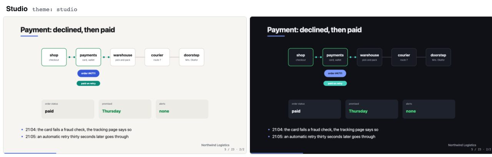
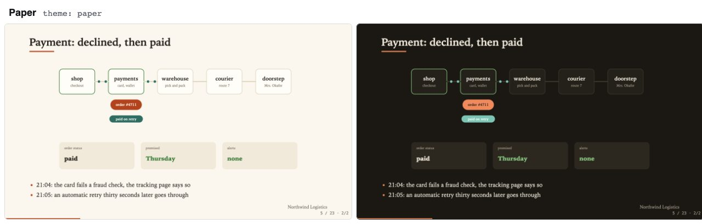
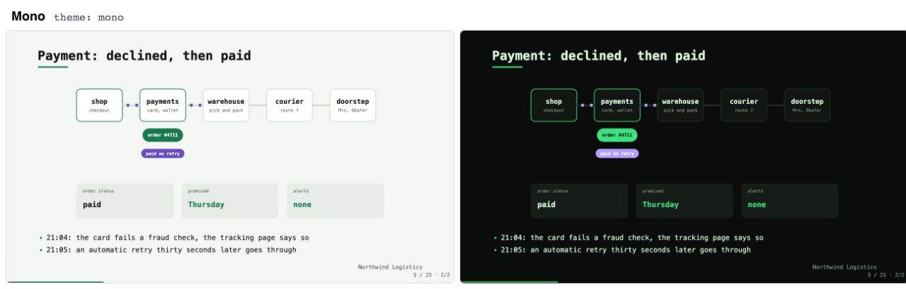
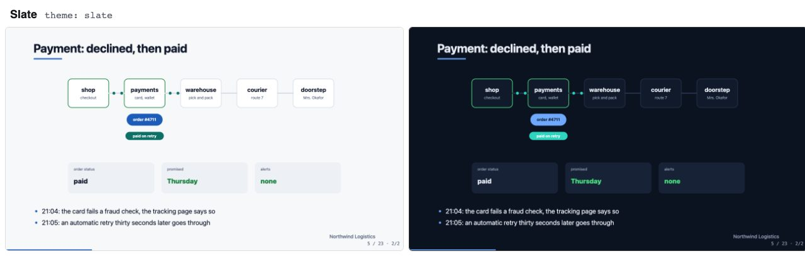
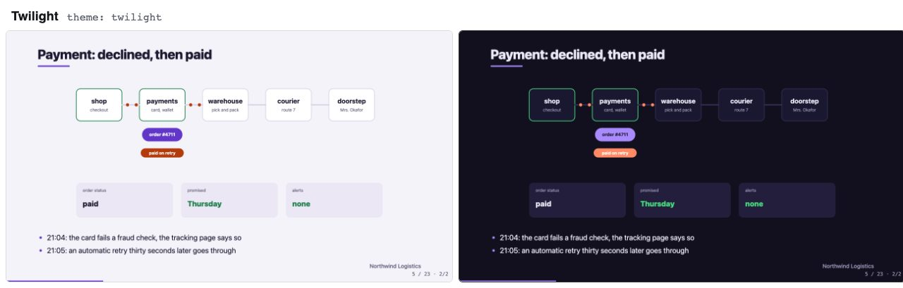
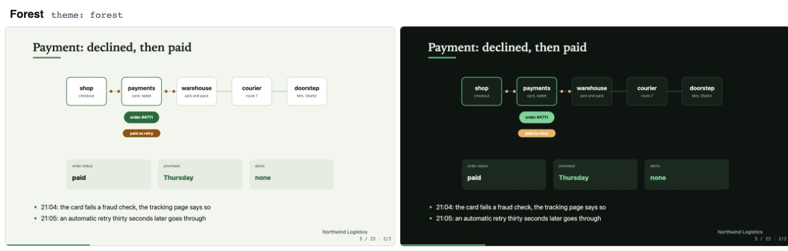
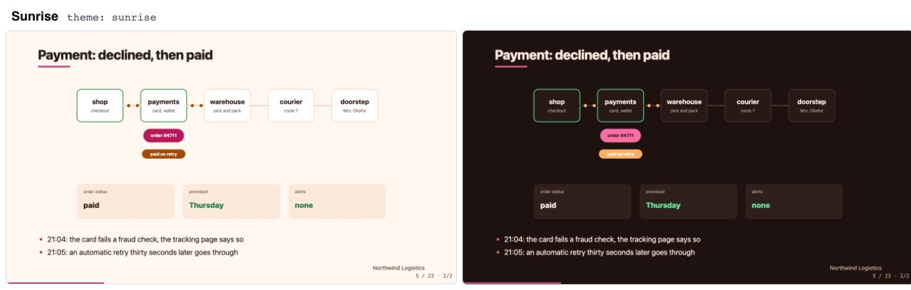
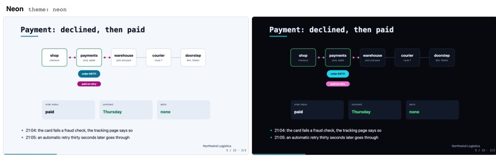
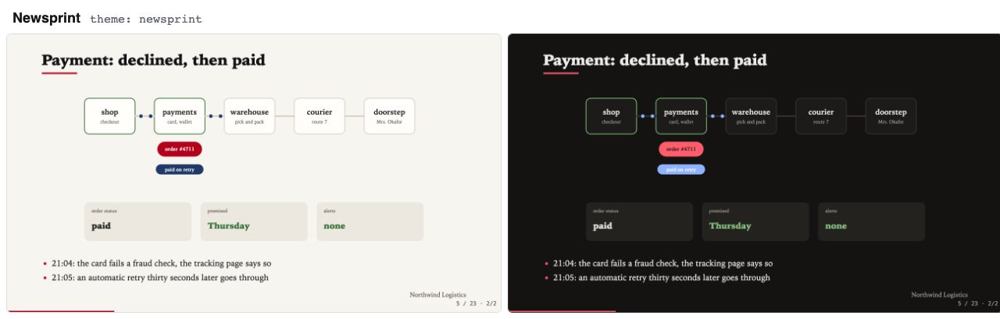

# simple-ideas

[](https://github.com/felipeg48/simple-ideas/actions/workflows/ci.yml)
[](https://github.com/felipeg48/simple-ideas/releases/latest)
[](go.mod)
[](https://goreportcard.com/report/github.com/felipeg48/simple-ideas)
[](LICENSE)
[](https://buymeacoffee.com/felipeg48)

**Docs, features and live examples: [simple-ideas.org](https://simple-ideas.org/)**

`si` turns markdown into animated slide decks that fill any screen. Write the
talk in markdown, run `si play` to present it with live reload, or build
self-contained HTML files you can mail, host or open from a USB stick.


- **One persistent SVG canvas** across slides: parts appear, fail, recover
  and move as the story goes, driven by state words in the markdown and CSS
  transitions in the SVG. Helpers animate reveals, pulses, growing bars,
  travelling dots and ticking counters — or scaffold one with `si new-canvas`.
- **Stage diagrams:** a ` ```stage ` fence generates themed, animated flow
  diagrams (chains, fan-out, merges) with a Mermaid-like syntax — native,
  offline, and step-drivable. See [docs/stage-diagrams.md](docs/stage-diagrams.md).
- **Fluid, never fixed:** no 1280×720 canvas; slides reflow from a phone to a
  4K screen, in portrait too.
- **Build steps** that reveal items and drive the canvas and stage state.
- **A real teleprompter:** notes in large type with auto-scroll, mirror mode,
  per-slide and total timers with pace, per-slide rehearsal timings, previews,
  synced with the audience window.
- **Live terminal drawer** (`si play` only): press `` ` `` to slide up a tabbed,
  real shell and run commands mid-demo (`docker ps`, `psql`,
  `redis-cli`) without leaving the slides. Loopback-only and never in a built
  deck — see [docs/terminal.md](docs/terminal.md).
- **Present with ease:** jump to any slide with the `/` find palette (search
  titles and text, or type a number); a full-screen break timer (digital or
  analog) with an optional animation; and a pen to annotate the slide live.
- **Backgrounds and images:** colours, gradients, images and muted video
  backgrounds with overlays; sized, aligned, captioned and full-bleed images.
- **Self-contained output:** CSS, JS, SVGs, images and video in one HTML file;
  or `si build --pdf` for a PDF per deck. Open on a phone with a QR code.
- **Articles and guides, not only slides:** `type: article` for a long read
  (lede, reading time, contents on the right), and a folder with a `_nav.md`
  for a multi-page guide (sidebar, breadcrumb, Previous / Next, shared header
  and footer, checked links and anchors). Labs (`type: lab`) for hands-on
  work. `si serve` shows them all live; `si --export example --type guide`
  gives a working one to copy (RULES.md §18–20). **Books**: `type: book` in
  `_nav.md` adds a cover, numbered chapters, sections, figures and tables,
  cross-references, an index, and a one-file edition and PDF (§21). **Demo
  scripts** (`type: demo`) are the presenter's run sheets: facts, `> Say:`
  lines, commands with expected output, and Copy / Run in the `si play`
  terminal (§22).
- **Sites (v1.0):** a folder with a `_site.md` becomes a site: a navigator
  (`topbar`, `topbar-centred`, `mega`, `sidebar`) with dropdowns and a phone
  menu, plain pages beside articles, talks, guides and books, and plugins for
  alerts, badges, event countdowns, accordions, modals, image carousels and
  embedding any other document or deck's slides. Still one self-contained
  HTML file per page; `si --export example --type site` (§23).
- **Mind maps (v1.12):** `type: mindmap` turns a nested list into a map
  (layouts map, right, org, radial; curved, straight, orthogonal or tapered
  lines; box, pill or underline topics; five map themes). Topics carry badges,
  pictures, sticky notes, highlighted code and links to slides or pages;
  `→ other.md` drills into another map with a zoom (inlined, so it works
  offline). Drag topics, fold branches, `/` searches every map, Play walks the
  branches. A ```` ```mindmap ```` fence puts one on a slide or in an article
  (§24).
- **3D mind maps (v1.13):** `view: 3d` draws the same maps as pills on a floor
  (isometric or perspective camera), cables with flowing dots, and the maps a
  topic links to as glass floors above it; fly in with a double-click, search
  with `/`, Play branch by branch, switch 2D/3D on the page. three.js is inlined
  only into pages with a 3D map.
- **3D kinds (v1.14):** `kind: bricks` builds the map from studded bricks on a
  baseplate with printed labels; `kind: toy` makes it a cartoon island (outlined
  candy shapes, roads, trees, clouds). A button cycles Blocks, Bricks and Toy.
- **The mind map builder (v2.0):** the Studio (`si --web` and the desktop app)
  opens a mind map as a map you edit directly: click a topic, Tab adds a child,
  Enter a sibling, type to rename, drag a topic onto another to move it there,
  Shift-drag to place it, panels for badges, links, pictures, sticky notes, code
  and the page's look. si writes every change back into the Markdown (the rest
  of the file stays as it was), as one undoable edit. Also new:
  `si build map.md --svg --png --pdf` (each map as SVG and PNG, one PDF page per
  map with working links), `si mindmap import` / `export` for OPML, FreeMind,
  XMind and Mermaid, `steps` on a slide to reveal one branch per click, and
  `flow: on` for dots running along the lines (§24).
- **Code windows (v2.1):** `window=mac|windows|terminal` on a code fence draws
  it as a window on a backdrop, with numbered callouts you drag into place
  (`<!-- callout: 3 text at=dx,dy -->`); fences with the same `id=` are a show
  whose lines glide from step to step, in documents (← → Play), on slides (one
  click per step, and across slides) and in mind maps. `si code file.md --png
  --svg --gif` exports every step and the animated show; the Studio's Window view
  edits it all (§25). Also: a fence without a language (``` title="config.csproj" ```) or
  in pandoc form (```{.xml title="x"}```) reads right; the title's extension names
  the language. Code is coloured more like an editor: calls and type names too,
  and labels read C#, JavaScript, Shell instead of CSHARP.
- **v2.1.1:** the desktop app runs a newer si you installed and tells you when a
  new release is out; the Studio editor completes code block and mind map
  options, include options and callout lines; a step's code is edited inside
  the Window view; a callout dragged in `si play` keeps its place in the
  Markdown; 3D mind maps on a phone start closer and offer a List view.
- **v2.2.0:** in `si play --terminal` a code show advances one step per click,
  with its title and callouts; Terraform/HCL, Protobuf, GraphQL, F# and Elixir
  are highlighted; `si build --share-assets` writes three.js once for a folder
  of 3D maps instead of into every page; pointer tests click, double-click and
  drag like a person on 3D maps, 2D maps and code windows.
- **v2.3.0:** `si publish` posts a deck to LinkedIn as a document post (its
  PDF, a swipeable carousel in the feed) and an article as a LinkedIn link or to
  dev.to / Hashnode, always as a dry run first (`--yes` sends; see
  `docs/publish.md`); `--mp4` films a code show or a mind map's Play (needs
  ffmpeg); `make docs-site` builds the rules into a browsable site with si itself
  (one page per RULES.md section, live examples on the home page); the Studio
  opens an empty folder with a start gallery of live starter thumbnails and a
  skippable tour.
- **v2.3.1:** the desktop Help menu opens the start gallery and the tour;
  `--mp4` also films decks (every slide and step; `--dwell` for a teaser) and 3D
  mind map Play; a LinkedIn link post carries a picture (`cover:`); ⌘K reaches
  the Studio from the map editor and previews; `.github/workflows/pages.yml`
  publishes the docs site to GitHub Pages once Pages is on (Settings ▸ Pages ▸
  Source: GitHub Actions) and the repository variable `SI_PAGES` is `on`
  (`gh variable set SI_PAGES --body on`).
- **v2.5.0:** a logo (the Stack, `docs/brand/`) on the app icon, the Studio
  and the docs site; Help and **About** in the Studio, the desktop app and
  `si --version --verbose` point to https://simple-ideas.org/; **Report a
  Problem / Request a Feature** open GitHub issue forms with the version, mode
  and OS filled in (`si report [--feature]`); the desktop build signs with a
  self-signed identity when you have one (`make desktop-cert`); `--mp4` films
  the real motion (transitions, canvas morphs, 3D camera flights; `--dissolve`
  for stills); review comments pin to a paragraph, bullet, code block or
  figure; the map editor edits in 3D; History, Review and About are in the
  accessibility check; sites take `favicon:`, `touch-icon:`, `og-image:`,
  `version:` and a picture-plus-name `logo:`.
- **v2.26.0:** Studio History: switch or make branches, Pull (fast-forward
  only) and Push with ahead/behind counts.
- **v2.25.0:** `si publish --to ghost` (Admin API, a JWT from your Admin API
  key) and `--to wordpress` (REST API, an application password): the article
  as HTML, a draft unless `--public`.
- **v2.24.0:** word clouds: `<!-- cloud: id -->` collects a few words from
  each phone under `si play --audience`; the slide sizes each word by its
  count, and the teleprompter can hide any word.
- **v2.23.0:** `--review --https` (and `--https=tailscale`): the review link
  over HTTPS, like the remote pages.
- **v2.22.0:** every example on the docs site shows its result under the
  Markdown and AsciiDoc tabs; `<!-- embed: … bare -->` embeds without a caption;
  the Decks page covers presenting (keys, overview, find, draw with the
  trackpad); a Your audience page.
- **v2.21.0:** the docs site shows every example of the rules, the manual and
  the feature pages in Markdown and AsciiDoc (tabs; the choice is remembered);
  AsciiDoc decks gain si's fence options in `[source,…]`, real `<1>` callouts,
  alerts from `NOTE:` / `[NOTE]` blocks and relative `link:` targets.
- **v2.20.0:** `<!-- poll: … · hidden -->` keeps a poll's bars for the next
  click, so the first votes do not sway the rest; `audience.save: off` in
  `si.conf` keeps no votes or questions; a Buy me a coffee badge.
- **v2.19.1:** the docs list nine built-in themes; three client themes stay in
  the code but leave the docs and site (see [TRADEMARKS.md](TRADEMARKS.md)).
- **v2.19.0:** remote audiences: `si play talk.md --tunnel` puts the audience
  side (follow along, polls, questions) on a temporary public HTTPS link
  (Cloudflare's free quick tunnel, `cloudflared`) for a talk on a video call;
  only the audience side, gone when `si play` stops.
- **v2.18.0:** questions from the room: under `si play --audience` every
  phone can ask; questions land in a Q&A tab on your teleprompter (never on the
  other phones), *Show on screen* puts one over the slide; votes and
  questions are saved beside the talk when `si play` stops.
- **v2.17.0:** live polls: `<!-- poll: id · option · option -->` on a slide;
  under `si play --audience` the room votes on their phones and the bars grow
  on your screen (one vote per phone, changeable); elsewhere a plain list.
- **v2.16.0:** the room follows along: `si play talk.md --audience` and
  `<!-- qr: audience -->` on a slide; phones show the current slide as you
  present, with their own key (never your controls) and never your notes.
- **v2.15.0:** six new themes: `slate`, `twilight`, `forest`, `sunrise`,
  `neon`, `newsprint` (each light and dark, contrast-checked), and a Themes
  page with a picture of every theme; a bottom-right footer no longer
  overlaps the slide counter on short screens.
- **v2.14.0:** handouts. `si build talk.md --handout` prints every slide,
  eight to a page, with a header and (with `handout-url:`) a QR code back to
  the live deck; no speaker text unless you ask: `--handout=lines` (space to
  write), `=points` (Points:), `=notes` (the Notes: script).
- **v2.13.0:** the key that draws with the cursor is yours to pick:
  `draw.hold: shift` (or `alt`, the default, `ctrl`, `meta`, `off`) in si.conf.
- **v2.12.0:** a menu-bar icon in si Studio for Mac: every running `si play`
  / `si serve` (from the app or a terminal) with Open in Browser,
  Teleprompter, Phone QR Codes…, Copy Link, Show in Finder and Stop; the app
  stays in the menu bar after its last window closes.
- **v2.11.0:** draw with the cursor: in draw mode (`a`), hold ⌥ Option (Alt)
  and move, and the cursor draws where it goes, no click; a trackpad draws with
  one finger. It replaces v2.10's `--trackpad` helper (absolute mapping felt
  out of tune), which is gone; `--trackpad` now just says so.
- **v2.9.1:** `si mcp` tool schemas every client accepts (Claude Code listed
  no tools with v2.9.0).
- **v2.9.0:** `si mcp`, an MCP server for AI agents (stdio, MCP 2026-07-28
  and earlier): `si_check` (problems as data), `si_rules`, `si_new`,
  `si_build`, `si_qr` and `si_screenshot` (the agent sees the slide); the
  Claude Code plugin includes it.
- **v2.8.0:** si for AI agents. The `si` skill (`SKILL.md` + one reference
  file per rules section) as a Claude Code plugin
  (`/plugin marketplace add felipeg48/simple-ideas`, `/plugin install
  si@simple-ideas`) and as `si --export skill` for any agent with skills;
  `AGENTS.md` for the others; https://simple-ideas.org/agents.html.
- **v2.7.0:** `si play talk.md --remote --https`: the phone and tablet pages
  over HTTPS, so a phone keeps its screen on and the notes stay private on any
  network. si makes a certificate authority of its own once (it can only vouch
  for local addresses) and each phone trusts it once, from a "first time" QR
  code; `--https=tailscale` uses a real certificate for your Tailscale name.
- **v2.6.0:** QR codes. `si qr https://…` writes a QR code as PNG, JPG, SVG
  or PDF, for a link, any text, a Wi-Fi network (`--wifi`) or a contact
  (`--vcard`), with your logo in the middle (`--logo`; a logo too big to scan
  past is refused, with the size that fits), round dots (`--style dots`) and
  your colours; `<!-- qr: https://… · caption=The slides -->` puts one on a
  slide or page; `q` in `si play --remote` shows the phone links as codes on
  the projected screen. si's own encoder now does every QR size (versions
  1-40) at every error correction level, each checked by a real reader.
- **v2.5.2:** the QR codes `si play` prints scan: they were unreadable
  before (a layout bug in si's own encoder), and the `--remote` ones are now
  short links (`/clicker?k=…`) that fit any address.
- **v2.5.1:** your phone as the remote: `si play talk.md --remote` gives an
  iPhone a teleprompter laid out for its screen (the script fills it, big Prev /
  Next) or the clicker; a phone that slept reconnects to the current slide, and
  the page keeps the screen on where the browser allows it (else it says to set
  Auto-Lock to Never); the docs site's rules pages carry the site's icon and
  footer.
- **v2.4.0:** the Studio's **History** panel (changed files and their diff,
  commit, a file's earlier versions with restore; git); **review links**
  (`si serve . --review`): reviewers on your network comment on slides and
  sections, the Studio's Review panel follows them live; `si check --budget`
  (and `budget.*` in si.conf) fails pages over 1 MB (3D maps 1.5 MB), and CI
  checks the examples; the map editor selects several topics and copies, cuts
  and pastes branches as Markdown lists; the terminal Studio edits mind map
  trees and code window looks.
- **In the terminal (v1.7):** `si play talk.md --terminal` presents a deck in
  the terminal itself, in the theme's colours, with block-letter titles, builds,
  code, tables, cards and pictures in half-block pixels; `--notes` in a second
  terminal is the teleprompter, following the presenter. Over SSH and in tmux.
  `si --terminal [dir]` (v1.8) is the Studio as a keyboard app: files, live
  preview, problems, New, Build, storyboard, inspector, Rehearse and Present,
  editing in your `$EDITOR`; and Lab (v1.9): the slide, the deck's runbook and demo
  commands, and a shell (a tmux pane, or output streamed in place). See
  `docs/terminal-studio.md`. Since v1.10 pictures are real pictures in Kitty,
  Ghostty, WezTerm and iTerm2, and `--notes` also follows a deck open in a browser.
- **si Studio for macOS (v1.6):** the browser editor (`si --web`) as a native
  app: its own windows, Dock icon, folders dropped on it open, teleprompter and
  full screen as app windows. Download `si-Studio-<version>-macos.zip` from a
  release (unsigned: right-click ▸ Open the first time). See `docs/desktop.md`.
- **Free web fonts (v1.1):** `fonts: heading=Fraunces:600, body=Inter:400;700`
  from Google Fonts, Bunny Fonts, Fontshare, Fontsource or a local file,
  fetched once, cached, and inlined, so the file stays self-contained (§15).
- **Markdown or AsciiDoc:** author decks in `*.md` or `*.adoc` — both feed the
  same pipeline ([docs/asciidoc.md](docs/asciidoc.md)).
- **Your own look:** nine built-in themes,
  a CSS theme file or URL, or your CSS on a documented `--si-*` token and
  `.si-*` hook contract.

## Install

**Download a release binary** (no Go needed) from the
[releases page](https://github.com/felipeg48/simple-ideas/releases) — pick your
OS/arch, then:

```bash
# macOS / Linux
chmod +x si_* && sudo mv si_* /usr/local/bin/si
# Windows: move si_*.exe somewhere on your PATH
```

**Or build from source** (Go 1.26+). A one-off setup script checks for Go and
builds `bin/si`:

```bash
./setup.sh            # macOS / Linux
.\setup.ps1           # Windows (PowerShell)   — or: setup.bat
```

Or the usual Go tooling:

```bash
go install github.com/felipeg48/simple-ideas/cmd/si@latest
# or, from a clone — builds bin/si, copies it to ~/.bin, and offers to add
# ~/.bin to your PATH in .zshrc/.bashrc (override dir: make install INSTALL_DIR=~/bin)
make install
```

**Update** an installed binary in place (checksum-verified, no reinstall):

```bash
si selfupdate
```

## Quick start

```bash
si new talk                 # talk/talk.md uses every rule
si play talk --open         # present with live reload at http://127.0.0.1:7070/
si talk --output html/      # one self-contained HTML file per deck + index.html
si courses/ --site "Northwind Academy" -o site/     # a tiled landing page over many decks
si check talk               # validate; exit 1 on a problem
```

A deck is plain markdown:

```markdown
# The Thursday Promise

How one order crosses five teams and still arrives on time.

---

## Payment: declined, then paid

<!-- svg: assets/journey.svg +declined -->
<!-- steps: . -declined,retry,paid -->
- 21:04: the card fails a fraud check
- 21:05: an automatic retry goes through

Notes: (1.5 min)
The token reaches payments and turns red.
```

The full format, with an example for every rule: [RULES.md](docs/RULES.md)
(also `si rules`).

Or, if you prefer AsciiDoc, name the file `*.adoc` — si converts it and every
feature still works ([docs/asciidoc.md](docs/asciidoc.md)):

```asciidoc
= The Thursday Promise
:author: Logistics

How one order crosses five teams and still arrives on time.

== Payment: declined, then paid

NOTE: the token reaches payments and turns red.

* 21:04: the card fails a fraud check
* 21:05: an automatic retry goes through
```

## Use it with your AI agent

si ships an Agent Skill (how to write si decks and documents, the
check-and-look loop, every rule on demand) and an MCP server (`si mcp`). Both
need the `si` binary on your PATH ([Install](#install)).

**Claude Code: the plugin** (the skill and the MCP tools together):

```text
/plugin marketplace add felipeg48/simple-ideas
/plugin install si@simple-ideas
```

**Any agent with skills:** `si --export skill` writes it into
`.claude/skills/si/` (or `-o ~/.claude/skills/si` for every project).
**Codex, Cursor, Copilot, Gemini CLI:** `si --export agent-rules` writes
`AGENTS.md` and `CLAUDE.md`.

**The MCP server**, without the plugin:

```bash
claude mcp add si -- si mcp      # Claude Code
codex mcp add si -- si mcp       # Codex
```

Claude Desktop, Cursor and other MCP clients:

```json
{ "mcpServers": { "si": { "command": "si", "args": ["mcp"] } } }
```

(Use the full path from `which si` where the app does not see your PATH.)
Tools: `si_check` (problems as data: file, line, message), `si_rules` (one
section of the format), `si_new`, `si_build`, `si_qr`, `si_screenshot` (a
slide as a picture, so the agent sees what it made). It works in the folder
it starts in and refuses paths outside it. More:
https://simple-ideas.org/agents.html

## Commands

| Command | What it does |
|---|---|
| `si play <dir\|file.md> [--addr 127.0.0.1:7070] [--open] [--css path]... [--site text]` | serve the decks, rendered from markdown on every request; live reload over server-sent events when a deck, an asset or a stylesheet changes; the URL hash keeps your slide. Use `--addr 0.0.0.0:7070` to open on a phone (prints a LAN URL + QR). On a loopback address, press `` ` `` for a live terminal drawer; `--site text` titles the index page, as in `si build`. `--remote[=tp,draw,clicker]` adds a keyed second port for a tablet or phone: the teleprompter, a draw pad and a clicker that drive the projected deck (see [docs/remote.md](docs/remote.md)) |
| `si --web [dir] [--addr 127.0.0.1:7070] [--no-open]` | the Studio: edit decks in the browser with a live preview and the `si check` report; loopback only, opens a tokenised URL (see [docs/studio.md](docs/studio.md)) |
| `si [build] <dir\|file.md> [--output html/] [--css path]... [--no-inline-media] [--pdf] [--site text]` | write one self-contained HTML file per deck plus `index.html` (a landing page with a tile per deck); `--pdf` also renders `pdfs/<name>.pdf` per deck and adds a PDF download badge to each tile (needs headless Chrome); `--site text` (alias `--title`) sets the landing page's `<title>` and `<h1>` |
| `si serve <dir\|file.md> [--addr 127.0.0.1:7070] [--open] [--css path]...` | serve everything for readers with live reload: decks, articles, guides with their navigation, labs (no terminal drawer) |
| `si check <dir\|file.md>` | validate decks: title, directives, options, missing files, include cycles, malformed `stage` blocks, broken canvas SVGs |
| `si new <name>` | scaffold `<name>/<name>.md` with assets, a module and a theme; `--type article` (or deck, guide, book, site, page, lab, demo, mindmap) writes a small starter instead, added to the menu of the guide or site it lands in |
| `si fix <dir> [--write]` | turn raw-HTML components into si syntax (`==highlight==`, badge, logo, cards); a dry run unless `--write` |
| `si new-canvas <name>` | scaffold `<name>.svg` (a working animated canvas) + a deck to preview it |
| `si migrate <dir\|file> [--ai "<cmd>"]` | print an editorial-migration prompt for an existing deck; `--ai "claude -p"` pipes it to an agent |
| `si manual [--slides] [--pdf] [--out dir]` | render the built-in user manual as self-contained HTML (and PDF with `--pdf`) |
| `si selfupdate` | download the latest release for your OS/arch (checksum-verified) and replace the running `si` |
| `si qr <text\|URL> [-o name.png] [--png --jpg --svg --pdf] [--logo pic] [--style dots]` | a QR code file for a link, text, `--wifi` network or `--vcard` contact; a logo too big to scan past is refused (see [QR codes](https://simple-ideas.org/features/qr.html)) |
| `si play <file.md> --audience` | the room follows the talk on their phones: their own key, slides only, never your notes; `<!-- qr: audience -->` puts the code on a slide, `<!-- poll: … -->` asks them, with live bars; their questions reach your teleprompter's Q&A tab |
| `si play <file.md> --tunnel` | the audience side on a temporary public HTTPS link (Cloudflare quick tunnel; `brew install cloudflared`), for a remote audience on a video call; gone when `si play` stops |
| `si play <file.md> --remote --https[=tailscale]` | the phone and tablet pages over HTTPS; each phone trusts si's local certificate authority once (see [Present from your phone](https://simple-ideas.org/features/remote.html)) |
| `si ca [trust\|untrust]` | si's certificate authority for `--https`: where it is, its fingerprint; `trust` adds it to this computer's trusted certificates |
| `si mcp [dir]` | an MCP server for AI agents on stdio (see [Use it with your AI agent](#use-it-with-your-ai-agent)) |
| `si rules` | print RULES.md |
| `si build <dir\|file.md> --handout[=slides\|lines\|points\|notes]` | `handouts/<name>.pdf` for the audience: slides only by default; `lines` adds space to write, `points` / `notes` add the speaker's text; `handout-url:` prints a QR code to the live deck |
| `si --theme <name\|file.css\|url>` | override the theme: a built-in (`si theme list`: `studio`, `paper`, `mono`, `slate`, `twilight`, `forest`, `sunrise`, `neon`, `newsprint`), a CSS file, or an `https://` URL |
| `si theme list` | list the built-in themes: name, display name, aliases, summary |
| `si --export css-rules\|rules\|conf\|example\|themes\|agent-rules\|skill [--output path]` | `skill`: the si Agent Skill (`SKILL.md` + references, default `.claude/skills/si/`) · starter stylesheet · RULES.md · starter `si.conf` · the showcase decks · a sample deck per theme (a gallery) · `CLAUDE.md` + `AGENTS.md` for a deck project, so a coding agent writes decks the si way (teleprompter `Notes:` as spoken script, `Points:` as talking points; never overwrites, `-o -` prints) |

Flags are GNU style and go before or after the path:
`si --css css/ --output html/ md/` and `si md/ -o html/` both work.
Exit codes: 0 ok, 1 deck problems or runtime error, 2 usage.

## Screenshots

| | |
|---|---|
|  |  |
|  |  |
|  |  |

Phone, 400×800: 


The `si play` terminal drawer (loopback only), two tabs and a live shell:


More in [docs/screenshots](docs/screenshots/).

## Themes

Nine built-in themes, each in light and dark (the reader's setting, or `d`
while presenting). Use one by name: `theme: twilight` in front matter,
`--theme twilight`, or `theme: twilight` in `si.conf`. More on
[the Themes page](https://simple-ideas.org/themes.html).

<table>
<tr><td width="50%"><br><code>theme: studio</code></td><td width="50%"><br><code>theme: paper</code></td></tr>
<tr><td width="50%"><br><code>theme: mono</code></td><td width="50%"><br><code>theme: slate</code></td></tr>
<tr><td width="50%"><br><code>theme: twilight</code></td><td width="50%"><br><code>theme: forest</code></td></tr>
<tr><td width="50%"><br><code>theme: sunrise</code></td><td width="50%"><br><code>theme: neon</code></td></tr>
<tr><td width="50%"><br><code>theme: newsprint</code></td><td width="50%"></td></tr>
</table>

## Styling

Pick a built-in theme in front matter (`theme: twilight`), point `theme:` at a CSS
file or an `https://` URL, or layer your own CSS:

```bash
si --export css-rules --output my-theme.css   # edit tokens and hooks
si play --css my-theme.css decks/
si --export themes && si play si-themes        # browse every built-in theme
```

Your `--css` loads in the `si.user` cascade layer after the built-in theme, so
it wins without specificity games; the fluid layout mechanics stay built in.
`examples/css/harbor.css` is a complete brand theme (usable as `theme: harbor.css`).

## Documentation

- **[User manual](docs/reference/user-manual.md)** — rules, syntax, examples
  (also `si manual --slides` / `si manual --pdf`)
- **[RULES.md](docs/RULES.md)** — the complete format reference (also `si rules`)
- [docs/stage-diagrams.md](docs/stage-diagrams.md) — the `stage` flow DSL
- [docs/authoring-canvases.md](docs/authoring-canvases.md) — hand-authored animated canvases
- [docs/timer-animations.md](docs/timer-animations.md) — the break-timer animation layer
- [docs/asciidoc.md](docs/asciidoc.md) — authoring decks in AsciiDoc (`.adoc`)
- **[Developer reference](docs/reference/developer-reference.md)** — architecture and how to extend si

## Development

```bash
make test           # go vet + go test ./...
make build          # bin/si
make play-example   # si play examples --open
```

See [CLAUDE.md](CLAUDE.md) and the
[developer reference](docs/reference/developer-reference.md) for the code layout
and how to add a directive, theme, canvas helper or timer animation.

## Support si

si is free and open source. If it saves you time, you can
[buy me a coffee](https://buymeacoffee.com/felipeg48): it pays for the
time, and maybe one day for a hosted relay.

## License

Licensed under the Apache License, Version 2.0 — see [LICENSE](LICENSE).
© 2026 Felipe Gutierrez.

## Trademarks

CockroachDB and Cockroach Labs are trademarks of Cockroach Labs, Inc.; AceMQ
is a trademark of its respective owner. si is an independent project, not
affiliated with or endorsed by them. See [TRADEMARKS.md](TRADEMARKS.md).
