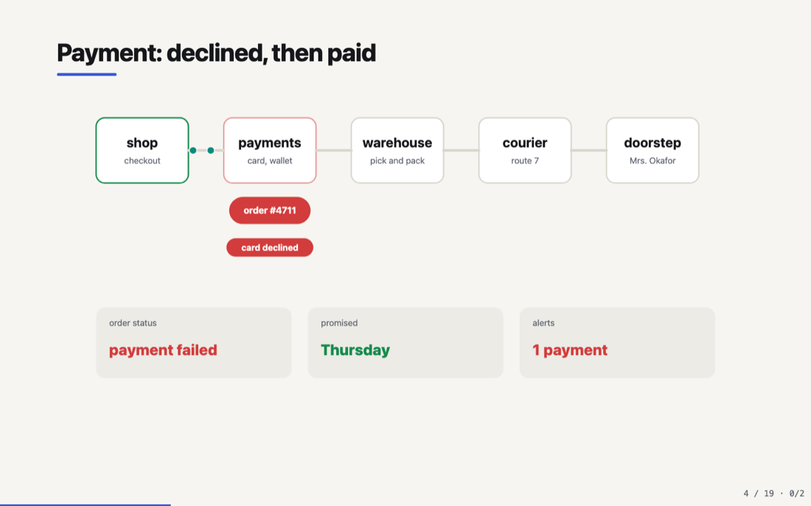
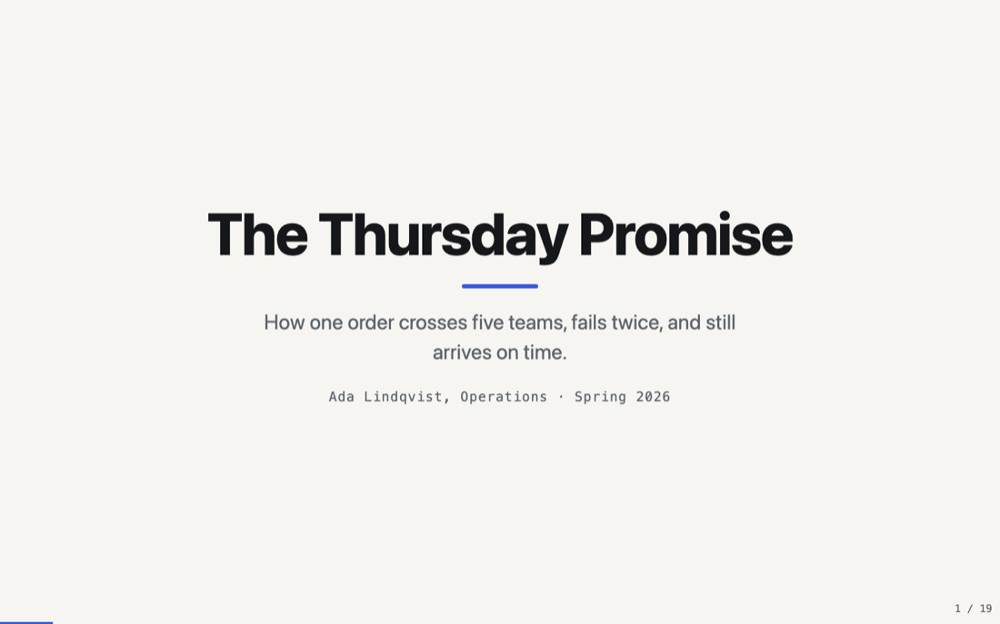
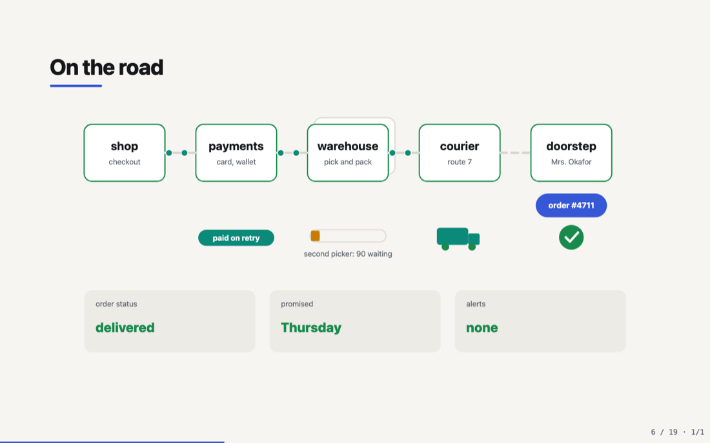
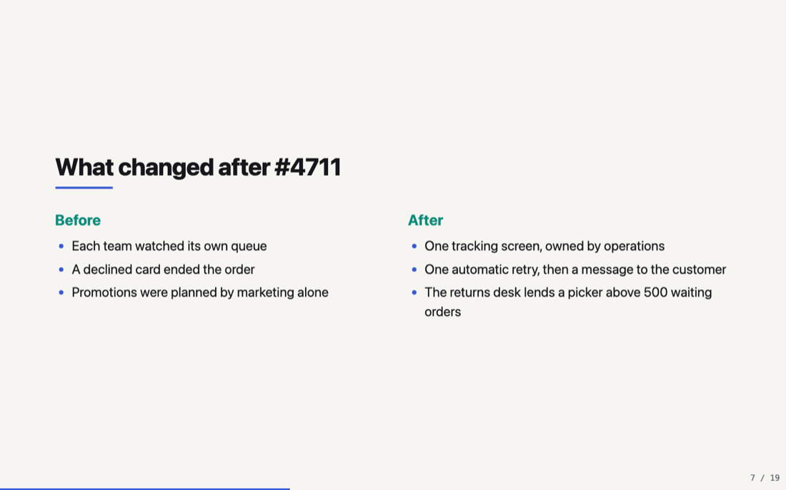
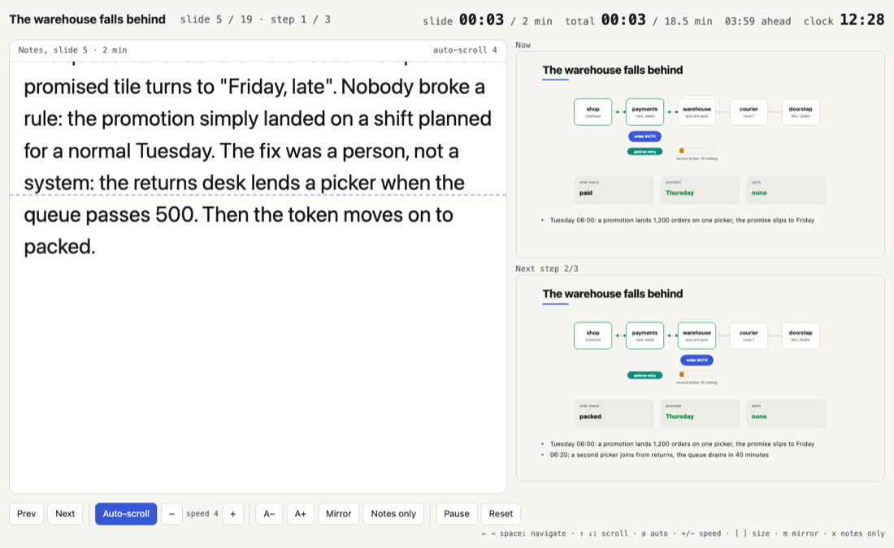
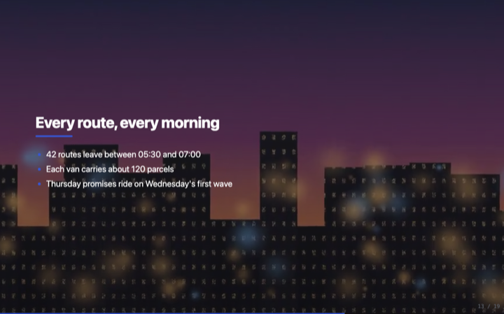
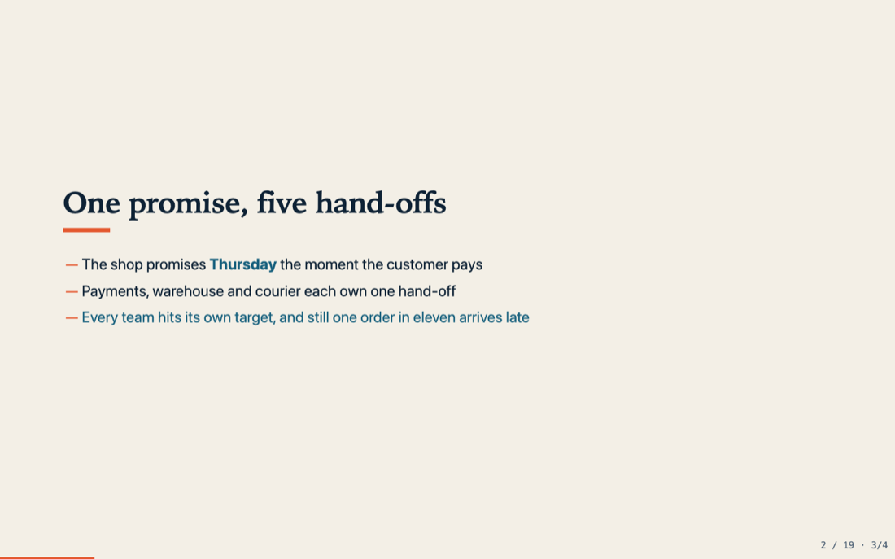
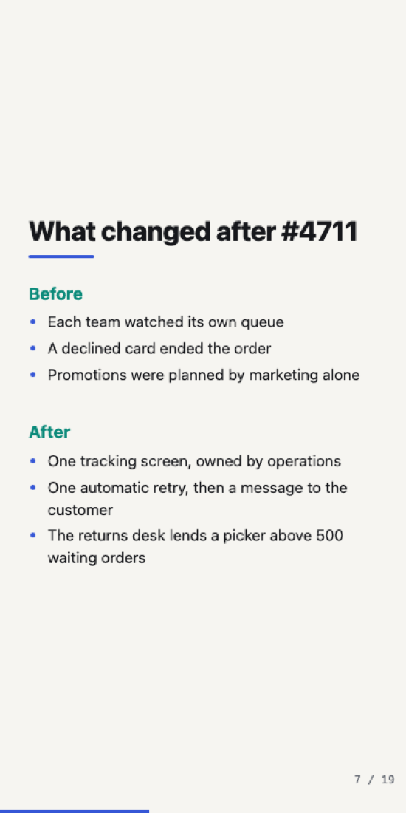
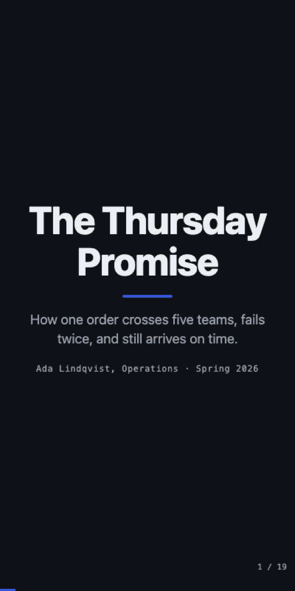

# simple-ideas

`si` turns markdown into animated slide decks that fill any screen. Write the
talk in markdown, run `si play` to present it with live reload, or build
self-contained HTML files you can mail, host or open from a USB stick.



- **One persistent SVG canvas** across slides: parts appear, fail, recover
  and move as the story goes, driven by state words in the markdown and CSS
  transitions in the SVG. Helpers animate reveals, pulses, growing bars,
  travelling dots and ticking counters — or scaffold one with `si new-canvas`.
- **Stage diagrams:** a ` ```stage ` fence generates themed, animated flow
  diagrams (chains, fan-out, merges) with a Mermaid-like syntax — native,
  offline, and step-drivable. See [docs/stage-diagrams.md](docs/stage-diagrams.md).
- **Fluid, never fixed:** no 1280×720 canvas; slides reflow from a phone to a
  4K screen, in portrait too.
- **Build steps** that reveal items and drive the canvas and stage state.
- **A real teleprompter:** notes in large type with auto-scroll, mirror mode,
  per-slide and total timers with pace, per-slide rehearsal timings, previews,
  synced with the audience window.
- **Backgrounds and images:** colours, gradients, images and muted video
  backgrounds with overlays; sized, aligned, captioned and full-bleed images.
- **Self-contained output:** CSS, JS, SVGs, images and video in one HTML file;
  or `si build --pdf` for a PDF per deck. Open on a phone with a QR code.
- **Your own look:** four built-in themes (incl. the CockroachDB `crdb` brand),
  a CSS theme file or URL, or your CSS on a documented `--si-*` token and
  `.si-*` hook contract.

## Install

Go 1.26 or newer:

```bash
go install github.com/felipeg48/simple-ideas/cmd/si@latest
# or, from a clone
make install
```

## Quick start

```bash
si new talk                 # talk/talk.md uses every rule
si play talk --open         # present with live reload at http://127.0.0.1:7070/
si talk --output html/      # one self-contained HTML file per deck + index.html
si check talk               # validate; exit 1 on a problem
```

A deck is plain markdown:

```markdown
# The Thursday Promise

How one order crosses five teams and still arrives on time.

---

## Payment: declined, then paid

<!-- svg: assets/journey.svg +declined -->
<!-- steps: . -declined,retry,paid -->
- 21:04: the card fails a fraud check
- 21:05: an automatic retry goes through

Notes: (1.5 min)
The token reaches payments and turns red.
```

The full format, with an example for every rule: [RULES.md](RULES.md)
(also `si rules`).

## Commands

| Command | What it does |
|---|---|
| `si play <dir\|file.md> [--addr 127.0.0.1:7070] [--open] [--css path]...` | serve the decks, rendered from markdown on every request; live reload over server-sent events when a deck, an asset or a stylesheet changes; the URL hash keeps your slide. Use `--addr 0.0.0.0:7070` to open on a phone (prints a LAN URL + QR) |
| `si [build] <dir\|file.md> [--output html/] [--css path]... [--no-inline-media] [--pdf] [--title text]` | write one self-contained HTML file per deck plus `index.html`; `--pdf` also writes a PDF per deck (needs headless Chrome); `--title` sets the index heading |
| `si check <dir\|file.md>` | validate decks: title, directives, options, missing files, include cycles, malformed `stage` blocks, broken canvas SVGs |
| `si new <name>` | scaffold `<name>/<name>.md` with assets, a module and a theme |
| `si new-canvas <name>` | scaffold `<name>.svg` (a working animated canvas) + a deck to preview it |
| `si rules` | print RULES.md |
| `si --theme <name\|file.css\|url>` | override the theme: a built-in (`studio`, `paper`, `mono`, `crdb`), a CSS file, or an `https://` URL |
| `si --export css-rules\|rules\|conf\|example\|themes [--output path]` | starter stylesheet · RULES.md · starter `si.conf` · the showcase decks · a sample deck per theme (a gallery) |

Flags are GNU style and go before or after the path:
`si --css css/ --output html/ md/` and `si md/ -o html/` both work.
Exit codes: 0 ok, 1 deck problems or runtime error, 2 usage.

## Screenshots

| | |
|---|---|
|  |  |
|  |  |
|  |  |

Phone, 400×800: 


More in [docs/screenshots](docs/screenshots/).

## Styling

Pick a built-in theme in front matter (`theme: crdb`), point `theme:` at a CSS
file or an `https://` URL, or layer your own CSS:

```bash
si --export css-rules --output my-theme.css   # edit tokens and hooks
si play --css my-theme.css decks/
si --export themes && si play si-themes        # browse every built-in theme
```

Your `--css` loads in the `si.user` cascade layer after the built-in theme, so
it wins without specificity games; the fluid layout mechanics stay built in.
`examples/css/harbor.css` is a complete brand theme (usable as `theme: harbor.css`).

## Development

```bash
make test           # go vet + go test ./...
make build          # bin/si
make play-example   # si play examples --open
```

See [CLAUDE.md](CLAUDE.md) for the code layout and how to add a directive.
