<p align="center">
  <a href="https://simple-ideas.org/"></a>
</p>

<h1 align="center">simple-ideas</h1>

<p align="center"><b>Markdown in. Talks, articles, guides, books, mind maps, code shows and whole websites out.</b><br>
Fluid on every screen, one self-contained HTML file each, with a real teleprompter.</p>

<p align="center">
<a href="https://github.com/felipeg48/simple-ideas/actions/workflows/ci.yml"></a>
<a href="https://github.com/felipeg48/simple-ideas/releases/latest"></a>
<a href="go.mod"></a>
<a href="https://goreportcard.com/report/github.com/felipeg48/simple-ideas"></a>
<a href="LICENSE"></a>
<a href="https://buymeacoffee.com/felipeg48"></a>
</p>

<p align="center">
<a href="https://simple-ideas.org/"><b>simple-ideas.org</b></a> ·
<a href="https://simple-ideas.org/examples.html">Live examples</a> ·
<a href="https://simple-ideas.org/rules/">The rules</a> ·
<a href="https://simple-ideas.org/themes.html">Themes</a> ·
<a href="FEATURES.md">Every feature</a> ·
<a href="CHANGELOG.md">Changelog</a>
</p>

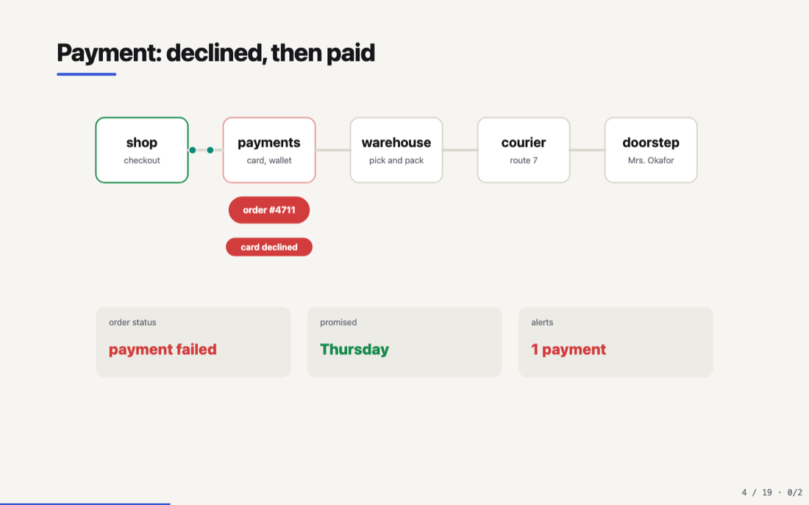

## Install

**A release binary** (no Go needed) from the
[releases page](https://github.com/felipeg48/simple-ideas/releases/latest):

```bash
chmod +x si_* && sudo mv si_* /usr/local/bin/si      # macOS / Linux
# Windows: move si_*.exe somewhere on your PATH
si selfupdate                                         # later: update in place, checksum-verified
```

**Or from source** (Go 1.26+): `go install github.com/felipeg48/simple-ideas/cmd/si@latest`,
or `make install` from a clone. On a Mac, **si Studio.app** is on the same
releases page.

## Thirty seconds

```bash
si new talk --type deck     # talk.md, a starter deck
si play talk.md --open      # present it, live reload; p opens the teleprompter
si build talk.md -o html/   # one self-contained HTML file, ready to send
```

```markdown
---
title: The Thursday Promise
---

# The Thursday Promise

How one order crosses five teams and still arrives on time.

---

## Payment: declined, then paid

<!-- svg: assets/journey.svg +declined -->
<!-- steps: . -declined,retry,paid -->
- 21:04: the card fails a fraud check
- 21:05: an automatic retry goes through

Notes: (1.5 min)
The order reaches payments and turns red. [CLICK] One retry later, it is paid.
```

Prefer AsciiDoc? Name the file `.adoc`: every feature works the same
([docs/asciidoc.md](docs/asciidoc.md)), and every example on the site has an
AsciiDoc tab.

## Watch it

Short narrated videos of si itself, filmed from scripts in
[`docs/demos/`](docs/demos) by `si demo run` on every minor release (they are
si's own end-to-end tests too). Click a picture to watch it on the site.

| | | |
|---|---|---|
| [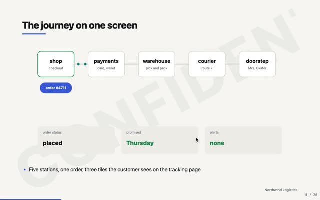](https://simple-ideas.org/features/decks.html) | [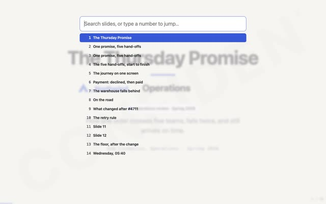](https://simple-ideas.org/features/decks.html#while-you-present) | [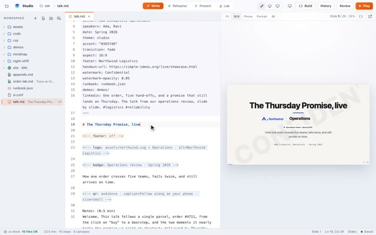](https://simple-ideas.org/features/studio.html) |
| **Decks:** new, play, check, build, PDF | **Presenting:** keys, overview, find | **Studio:** write, check, theme |
| [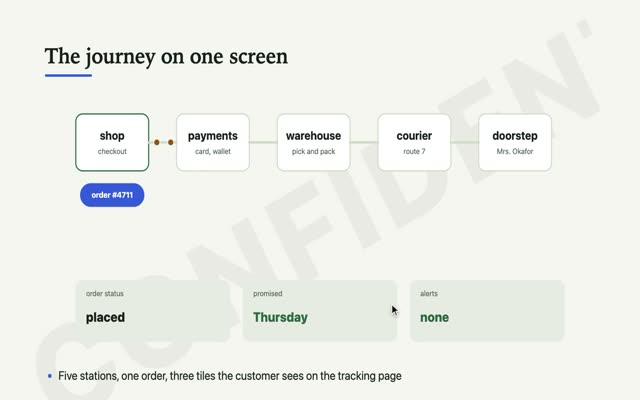](https://simple-ideas.org/themes.html) | [](https://simple-ideas.org/features/mindmaps.html) | [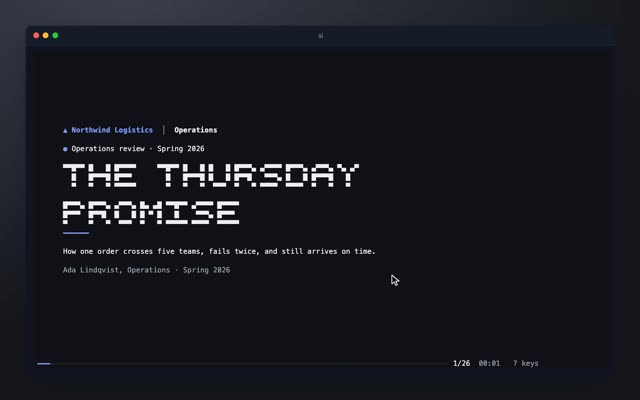](https://simple-ideas.org/features/terminal.html) |
| **Themes:** nine, and your logo's | **Mind maps:** a list, 2D, 3D | **Terminal:** slides and the Studio |

## Features

### Decks

Talks that fill any screen, from a phone to a 4K projector. Layouts, build
steps, an SVG canvas whose parts appear, fail and move slide after slide,
`stage` flow diagrams, Mermaid, highlighted code, backgrounds and video.
Present with overview (`o`), find (`/`), a break timer (`t`) and a pen (`a`;
hold ⌥ Option and the cursor draws). Film it with `--mp4`, print it with
`--pdf`, hand out `--handout`.
[Decks →](https://simple-ideas.org/features/decks.html)

<table><tr>
<td width="50%">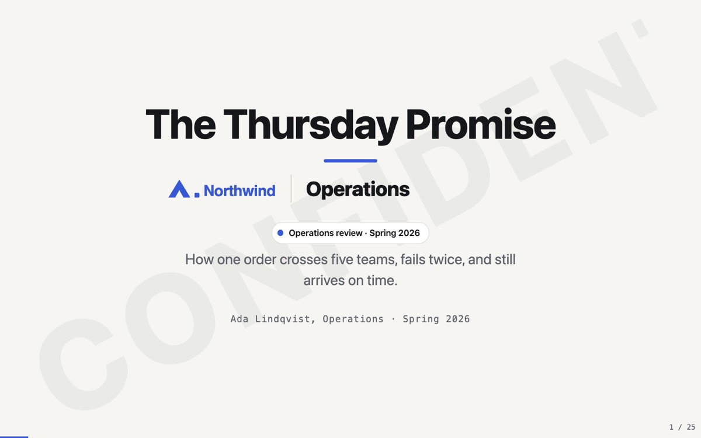</td>
<td width="50%">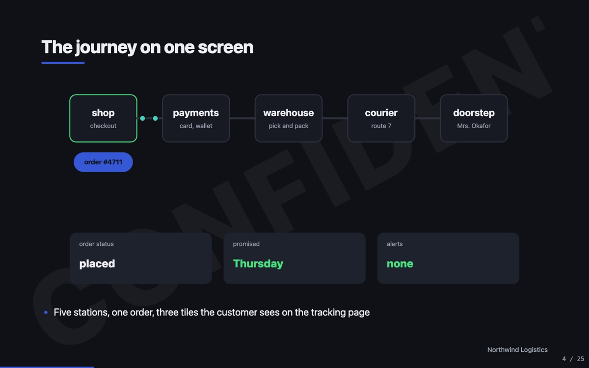</td>
</tr></table>

**A real teleprompter** (`p`): your `Notes:` script in large type, auto-scroll,
mirror, per-slide and total clocks with pace, previews of now and next.
**Two presenters?** `speakers: Ana, Felipe` and `Notes[Ana]:`: a teleprompter
each, with the hand-over. **Record your talk** with one button, then
`si build --narration latest` makes the narrated video and `si rehearse`
shows where you ran long.

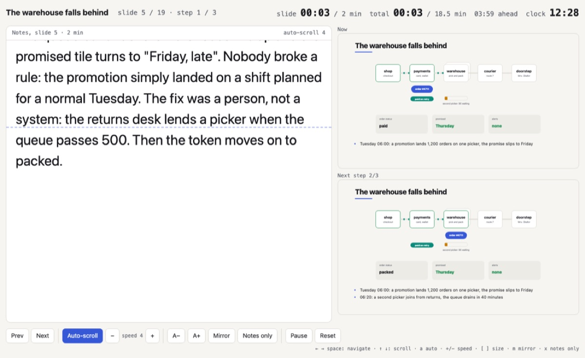

**Present from your phone** (`si play --remote --https`): your phone is the
clicker, a tablet the teleprompter or a pen pad.
**Your audience** (`--audience`): the room follows on their phones, votes in
live polls, answers in a word cloud and sends you questions; `--tunnel` does
the same on a video call. No accounts, no server in the middle.
[Presenting →](https://simple-ideas.org/features/remote.html) ·
[Audience →](https://simple-ideas.org/features/audience.html)

<p align="center">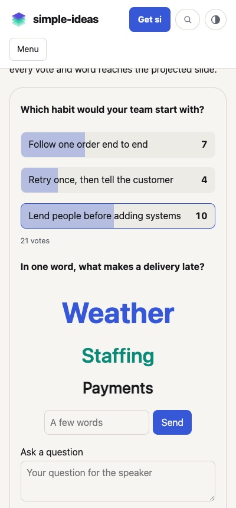</p>

### Articles

One readable page: a lede, reading time, a contents column, code with copy
buttons, callouts, tables. `si publish` sends it to LinkedIn, dev.to,
Hashnode, Ghost or WordPress, always as a dry run first.
[Articles →](https://simple-ideas.org/features/articles.html)

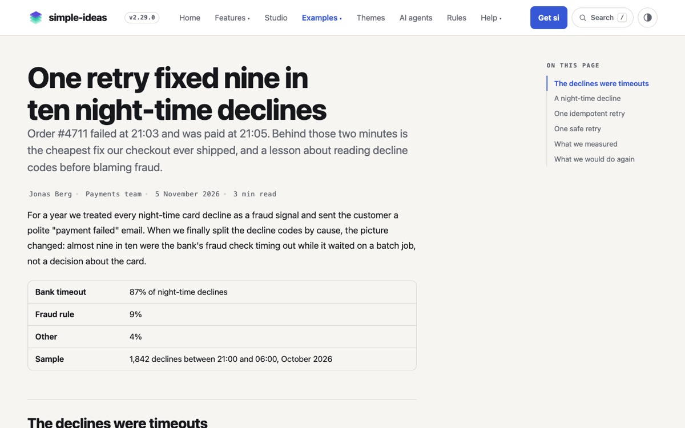

### Guides

A folder of pages with a sidebar, breadcrumbs, Previous / Next, progress and
checked links: tutorials, labs and docs.
[Guides →](https://simple-ideas.org/features/guides.html)

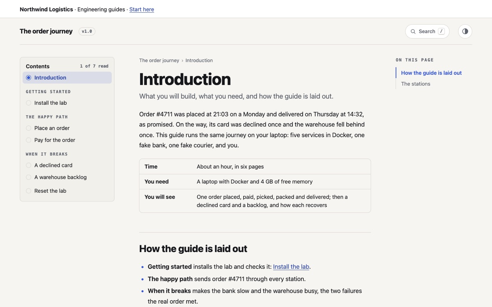

### Books

Chapters and parts, a cover, numbered figures and tables, cross-references,
an index, and a one-file edition and PDF.
[Books →](https://simple-ideas.org/features/books.html)

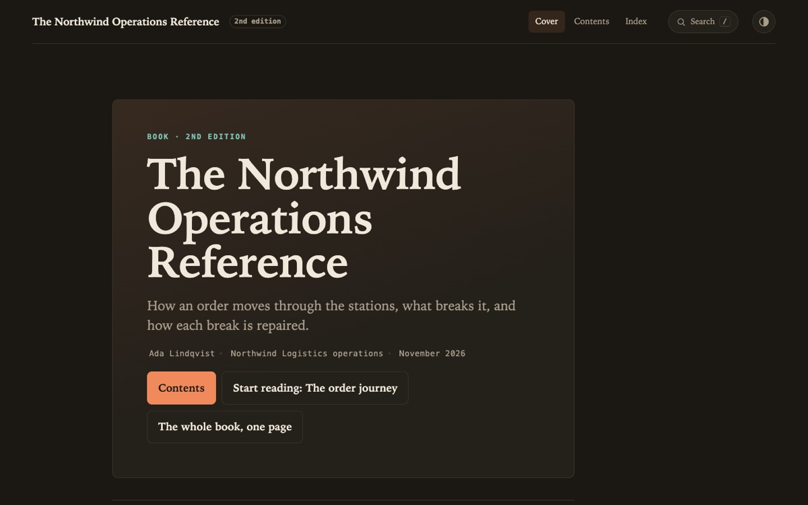

### Mind Maps

A nested list becomes a map: four layouts, line and topic styles, badges,
pictures, sticky notes, code, links that drill into other maps, folding,
search and Play. In 3D too, with floors for the maps a topic links to.
[Mind Maps →](https://simple-ideas.org/features/mindmaps.html)

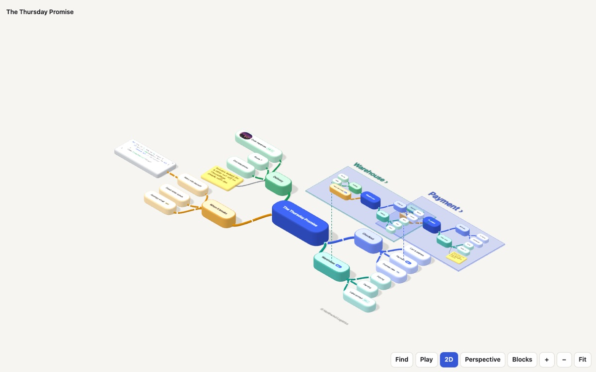

### Code

Code in a window (macOS, Windows, terminal), on a backdrop, with numbered
callouts and highlighted lines; a show that morphs from one step to the next.
Export PNG, SVG, GIF or MP4 with `si code`.
[Code →](https://simple-ideas.org/features/code.html)

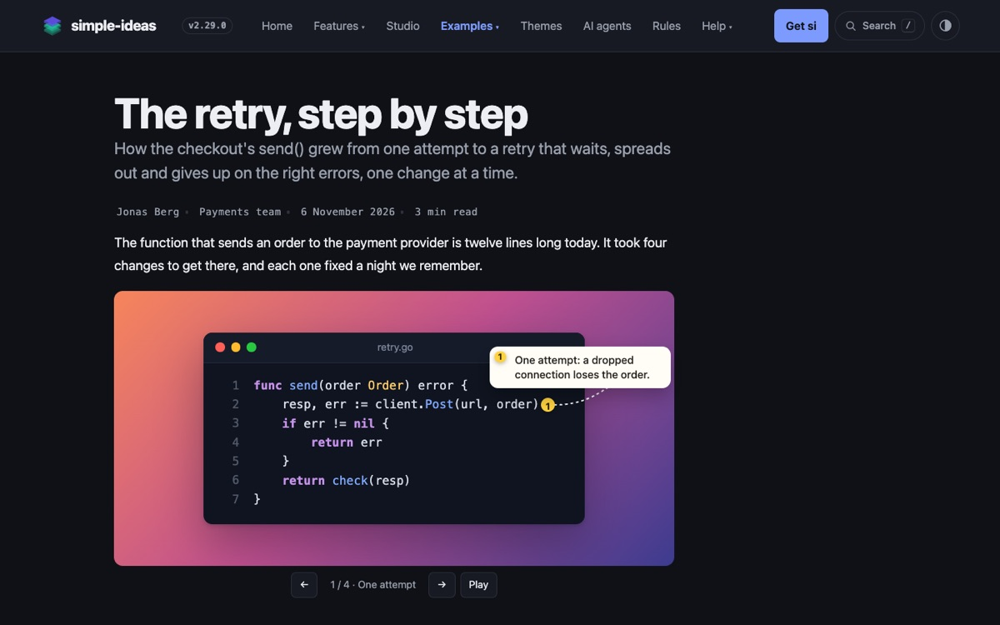

### Website

A folder with a `_site.md` is a whole website: a top bar or sidebar menu,
pages, blog posts, talks and guides inside it, search, light and dark.
`si new mysite --type website`, then `si build` and upload.
[Website →](https://simple-ideas.org/features/website.html)

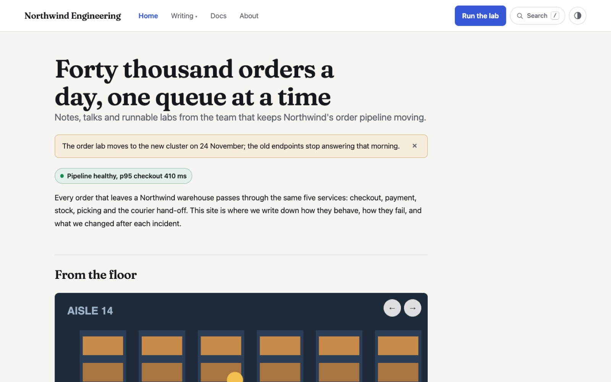

### Studio

Write, preview, rehearse and present in one window, in the browser
(`si --web .`) or as **si Studio.app** on a Mac: a live preview at any
screen size, `si check` as you type, a map editor, a code window builder,
History (git: commit, branches, pull, push) and reviews.
[Studio →](https://simple-ideas.org/features/studio.html)

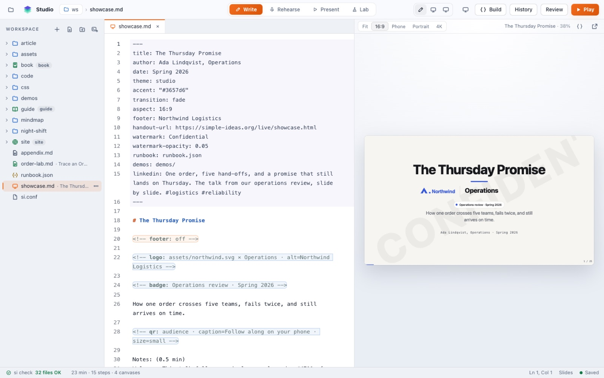

### Terminal

The same deck in a terminal, over SSH or in tmux: block-letter titles,
animated canvases, real pictures, a teleprompter in a second pane, and the
Studio as a keyboard app (`si --terminal .`).
[Terminal →](https://simple-ideas.org/features/terminal.html)

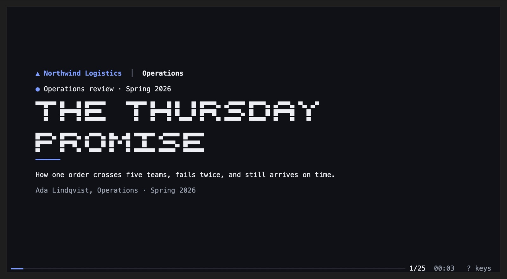

### QR Codes

`<!-- qr: https://… -->` on a slide or a page, or `si qr` for a PNG, JPG,
SVG or PDF with your logo in the middle, a Wi-Fi network or a contact.
[QR Codes →](https://simple-ideas.org/features/qr.html)

### Web demos

One Markdown script performs each feature of your web app the way a person
would. `si demo test` checks it (a report, JUnit for CI); `si demo run` films
it with a cursor, callouts and a narrated voice: one video per feature, one
with chapters, each also with captions under the picture. It can start your server in the background and type
commands into a real terminal on camera, check their output, then switch to
the browser. [Web demos →](https://simple-ideas.org/features/webdemos.html)

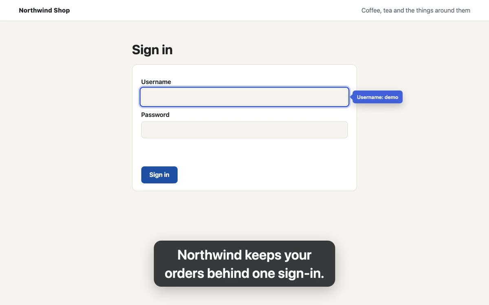

## Themes

Nine built-in themes, each in light and dark. `theme: twilight` in front
matter, or your own: a CSS file of `--si-*` tokens, made in the Studio's Theme
view or straight from your logo with `si theme from logo.svg`. Click one to see it on
[simple-ideas.org](https://simple-ideas.org/themes.html).

<table>
<tr>
<td align="center"><a href="https://simple-ideas.org/themes.html#studio"></a><br><code>studio</code></td>
<td align="center"><a href="https://simple-ideas.org/themes.html#paper"></a><br><code>paper</code></td>
<td align="center"><a href="https://simple-ideas.org/themes.html#mono"></a><br><code>mono</code></td>
</tr>
<tr>
<td align="center"><a href="https://simple-ideas.org/themes.html#slate"></a><br><code>slate</code></td>
<td align="center"><a href="https://simple-ideas.org/themes.html#twilight"></a><br><code>twilight</code></td>
<td align="center"><a href="https://simple-ideas.org/themes.html#forest"></a><br><code>forest</code></td>
</tr>
<tr>
<td align="center"><a href="https://simple-ideas.org/themes.html#sunrise"></a><br><code>sunrise</code></td>
<td align="center"><a href="https://simple-ideas.org/themes.html#neon"></a><br><code>neon</code></td>
<td align="center"><a href="https://simple-ideas.org/themes.html#newsprint"></a><br><code>newsprint</code></td>
</tr>
</table>

## External dependencies

`si` is one program and needs nothing else for writing, presenting, building
HTML, checking, the Studio, the teleprompter, the phone remote and the
audience. A few features use a program you install once; **`si doctor`**
lists them all, found or not, with the command for your computer.

| Program | Used for | macOS | Linux (Debian, Ubuntu) | Windows |
|---|---|---|---|---|
| Chrome or Chromium | `--pdf`, `--png`, `--svg`, `--handout`, `--mp4`, `si demo` | `brew install --cask google-chrome` | `sudo apt install chromium` | `winget install Google.Chrome` |
| ffmpeg | `--mp4`, `--narration`, `si code --gif`, `si demo run` | `brew install ffmpeg` | `sudo apt install ffmpeg` | `winget install Gyan.FFmpeg` |
| git | the Studio's History | `xcode-select --install` | `sudo apt install git` | `winget install Git.Git` |
| tmux | shell panes in `si --terminal` | `brew install tmux` | `sudo apt install tmux` | in WSL: `sudo apt install tmux` |
| cloudflared | `si play --tunnel` | `brew install cloudflared` | [pkg.cloudflare.com](https://developers.cloudflare.com/cloudflare-one/connections/connect-networks/downloads/) | `winget install --id Cloudflare.cloudflared` |
| Tailscale | `--https=tailscale` | `brew install --cask tailscale` | `curl -fsSL https://tailscale.com/install.sh \| sh` | `winget install Tailscale.Tailscale` |
| GitHub CLI | code from private GitHub repos | `brew install gh` | `sudo apt install gh` | `winget install GitHub.cli` |
| Kokoro | `si demo run`'s natural local voice | `si voice install kokoro` | `si voice install kokoro` | `si voice install kokoro` |
| eSpeak NG | `si demo run`'s computer voice on Linux | not needed (`say`) | `sudo apt install espeak-ng` | not needed |

Fedora and Arch commands are on each feature page of
[simple-ideas.org](https://simple-ideas.org/), and in `si doctor`.

## With your AI agent

si ships an Agent Skill (how to write si documents, every rule on demand) and
an MCP server (`si mcp`: check, rules, new, build, QR, a screenshot of a
slide). In Claude Code:

```text
/plugin marketplace add felipeg48/simple-ideas
/plugin install si@simple-ideas
```

Other agents: `si --export skill`, `si --export agent-rules` (AGENTS.md), or
`claude mcp add si -- si mcp` / `codex mcp add si -- si mcp`.
[AI agents →](https://simple-ideas.org/agents.html)

## Commands

| | |
|---|---|
| `si new <name> --type deck\|article\|guide\|book\|website\|lab\|mindmap\|codeshow` | a starter |
| `si play <dir\|file>` | present with live reload (`--remote`, `--audience`, `--tunnel`, `--review`, `--https`) |
| `si build <dir\|file> -o html/` | self-contained HTML (`--pdf`, `--mp4`, `--handout`, `--narration`) |
| `si check <dir\|file>` | every problem, with file and line |
| `si --web [dir]` · `si --terminal [dir]` | the Studio, in the browser or the terminal |
| `si demo test\|run <script>` | a web app's features as a test, or as narrated videos |
| `si publish <file> --to linkedin\|devto\|hashnode\|ghost\|wordpress` | post it (a dry run unless `--yes`) |
| `si code`, `si qr`, `si rehearse`, `si mcp`, `si rules`, `si manual` | code exports, QR codes, a recording's pace, the MCP server, the format, the manual |

`si --help` lists every option. The full format, with an example for every
rule: [the rules](https://simple-ideas.org/rules/) (also `si rules`), and the
[user manual](docs/reference/user-manual.md).

## Development

```bash
make test           # go vet + go test ./...
make build          # bin/si
make docs-site      # the simple-ideas.org site, built with si itself
```

Go standard library plus goldmark; see [CLAUDE.md](CLAUDE.md) for the code
layout and the [developer reference](docs/reference/developer-reference.md).

## Support si

si is free and open source. If it saves you time,
[buy me a coffee](https://buymeacoffee.com/felipeg48).

## License

Apache License 2.0, see [LICENSE](LICENSE). © 2026 Felipe Gutierrez.

CockroachDB and Cockroach Labs are trademarks of Cockroach Labs, Inc.; AceMQ
is a trademark of its respective owner. si is an independent project, not
affiliated with or endorsed by them. See [TRADEMARKS.md](TRADEMARKS.md).
