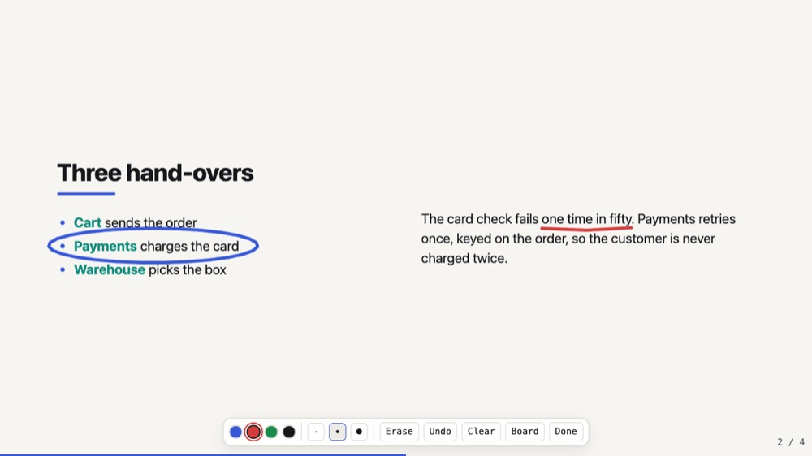
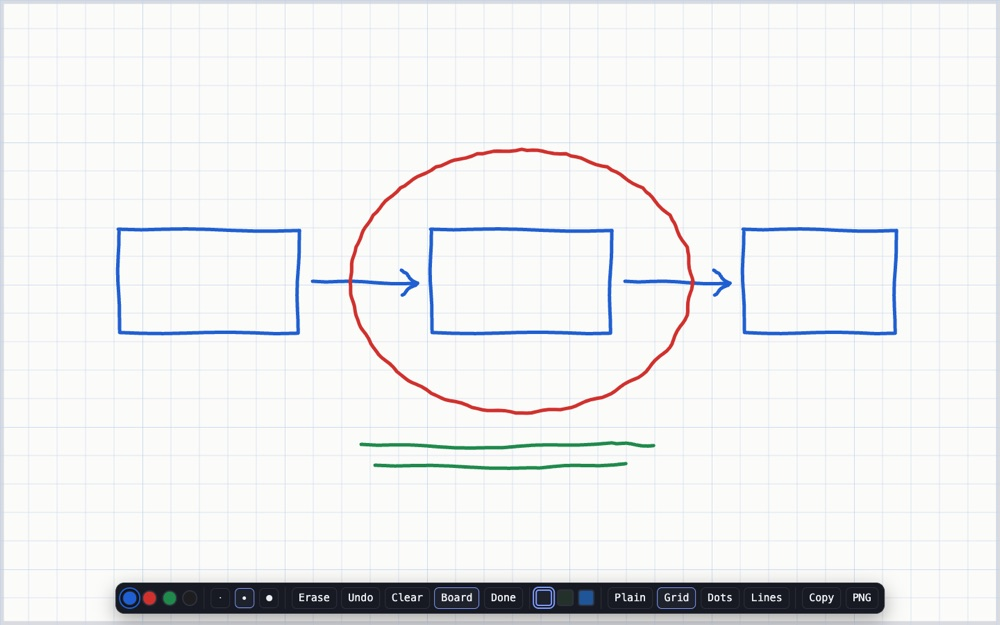
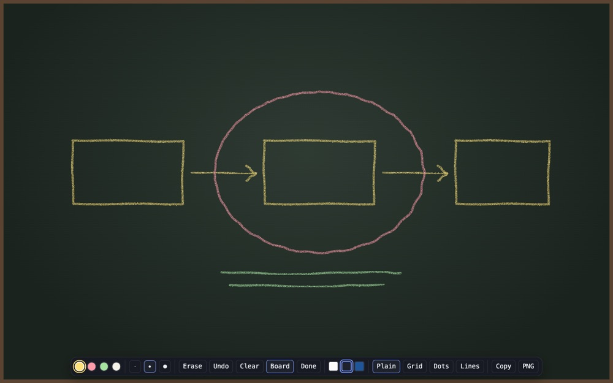
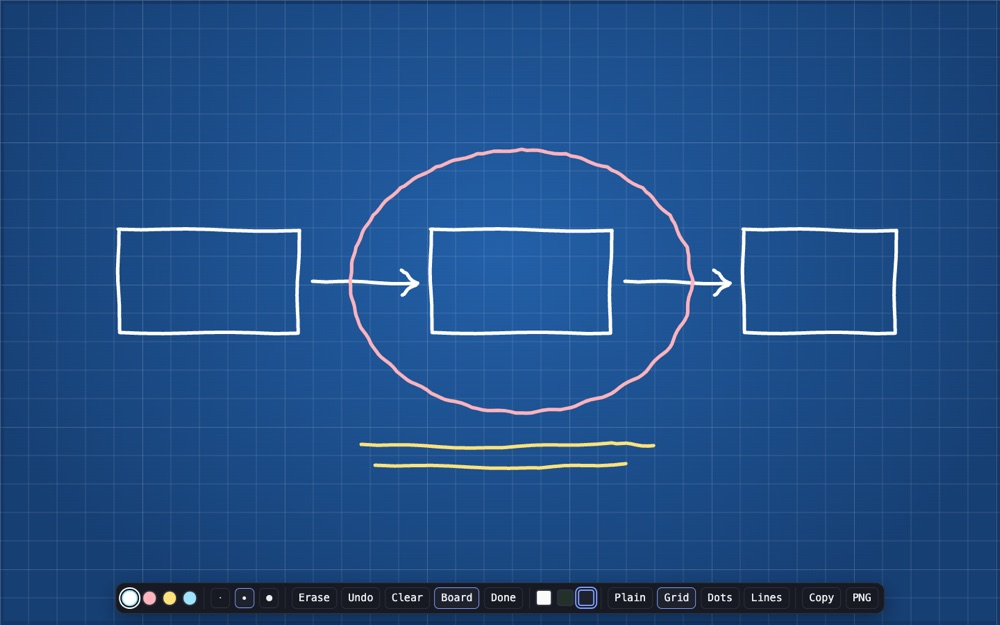

# Draw and the board

Press <kbd>a</kbd> and the pen is in your hand: ring the number that matters,
underline the sentence the room should remember. Press <kbd>b</kbd> and a
board slides over the deck, to sketch the thing that is not on any slide.
When you are done, **Copy** puts the board on the clipboard as a picture:
paste it into the chat, the ticket or the follow-up email.

```video src="img/draw/draw.mp4" poster="img/draw/draw.poster.jpg" autoplay muted loop title="Drawing on a slide, then on the board: graph paper, chalk, blueprint, copied"
```

## Try it

Click the deck, press <kbd>a</kbd> and drag on the slide. Then <kbd>b</kbd>
for the board, <kbd>B</kbd> for the next paper, <kbd>g</kbd> for the next
pattern, <kbd>Esc</kbd> to put it all away.

<!-- slides: showcase/draw.md -->

## On the slide

<div class="dk-grid">
<figure><figcaption><kbd>a</kbd> draws on the slide: drag with the mouse, a pen or a finger, or hold <kbd>⌥ Option</kbd> and move so one finger on the trackpad draws</figcaption></figure>
</div>

The ink belongs to the slide: move on and it is gone, so a ring never
follows you onto the next idea. <kbd>c</kbd> changes the colour, the dots in
the bar the size, <kbd>e</kbd> erases a stroke, <kbd>z</kbd> undoes the last
one, <kbd>x</kbd> clears them all.

## The board

<div class="dk-grid">
<figure><figcaption><b>Whiteboard</b>: blue, red, green and black markers</figcaption></figure>
<figure><figcaption><b>Blackboard</b>: every pen turns to chalk, grain and all</figcaption></figure>
<figure><figcaption><b>Blueprint</b>: white lines on a light grid</figcaption></figure>
</div>

The board sits over the slides, and its ink stays while you move between
them: sketch the system on the board, step through the slides, open it
again and the sketch is still there. Each paper picks pens that read on it,
and every pattern is drawn light so the ink stays the loudest thing.

| Key or button | What it does |
|---|---|
| <kbd>b</kbd> or **Board** | opens the board, or puts it away |
| <kbd>B</kbd> or the three swatches | white, black (chalk), blue (blueprint) |
| <kbd>g</kbd> or **Plain**, **Grid**, **Dots**, **Lines** | the pattern: plain, graph paper, dots, ruled |
| **Copy** | a picture of the board on the clipboard, to paste anywhere |
| **PNG** | saves it as `<deck>-board.png` |
| <kbd>z</kbd>, <kbd>x</kbd> | undo, clear: the ink only, the pattern stays |
| <kbd>Esc</kbd> | puts the pen and the board away |

The paper and the pattern you chose are remembered for the next talk. With
`ui.lang: es` in si.conf (or a deck with `lang: es`) the bar reads *Pizarra
blanca*, *Cuadrícula*, *Copiar*.

## From a tablet

With `si play --remote`, a tablet with a pen is a draw pad: what you draw on
it shows on the projected slide. See [Present from your phone](remote.md).
