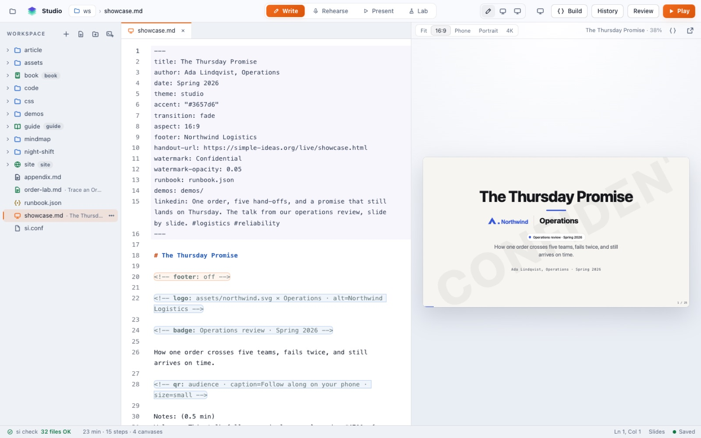
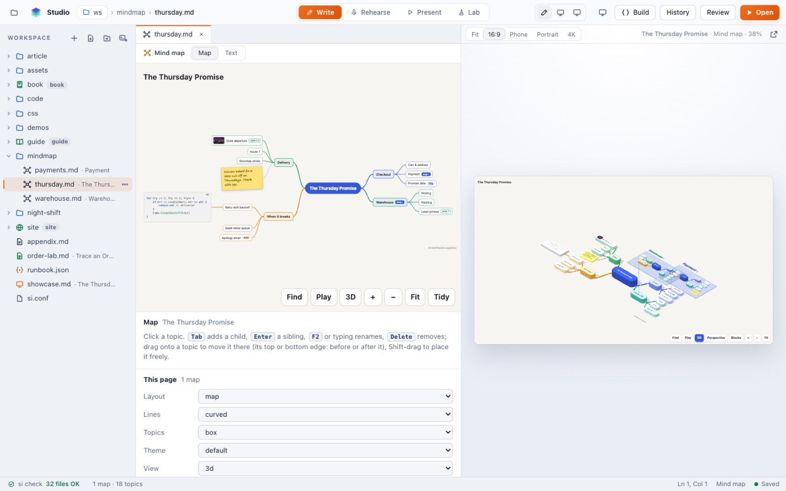
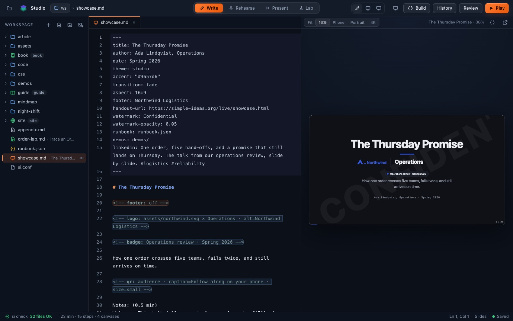

# Studio

The whole of si in one window. The Markdown on the left, the slide or page on
the right, the same renderer as `si play`, updated as you type. Run it in your
browser or as a Mac app; both are the same Studio.

```bash
si --web .                      # opens the Studio for this folder in your browser
```



## What it does

| | |
|---|---|
| **Write** | the editor completes directives, layouts, transitions and fence options; every file kind has a starter (**New**: slides, article, guide, book, site, page, lab, mind map, code show) |
| **Preview** | Fit, 16:9, Phone, Portrait and 4K, so you see how it reflows before anyone else does |
| **Check** | `si check` runs as you type; the status bar counts the problems and a click goes to the line |
| **Rehearse** | the slide and its `Notes:` script side by side, with the clock and pace |
| **Present** | **Play** opens the deck and its teleprompter |
| **Lab** | a deck's commands (runbook, demo scripts) beside a real terminal |
| **Map view** | edit a mind map by dragging topics; Tab adds a child, Enter a sibling |
| **Window view** | style a code window, its steps and callouts, and export it as PNG, SVG, GIF or MP4 |
| **Theme view** | make your own theme: start from a built-in, pick colours light and dark, fonts and sizes beside a live deck at four screen sizes, with contrast checks that **Fix** a pair that fails (**New theme** in ⌘K, File › New Theme… in the Mac app) |
| **History** | git without leaving the page: what changed, commit, earlier versions, branches, pull and push |
| **Review** | comments people leave from a review link (`si serve . --review`), live, to reply and resolve |
| **⌘K** | every file and command, fuzzy |



In dark mode the Studio follows your system:



## The Mac app

**si Studio.app** is the same Studio in its own window, with a Dock icon and
menus: folders dropped on the icon open, each folder gets its own window, and
the teleprompter and Play open as windows of the app. While it runs, a stack
icon in the menu bar lists every `si play` on your Mac, with the phone codes.

Download `si-Studio-<version>-macos.zip` from the
[latest release](https://github.com/felipeg48/simple-ideas/releases/latest)
(Apple silicon and Intel, macOS 13 or later), unzip it and move it to
Applications. The app is not notarised, so the first time right-click it and
choose **Open**, or run:

```bash
xattr -dr com.apple.quarantine "/Applications/si Studio.app"
```

On Windows and Linux, `si --web` gives you the same Studio in the browser.

## Safe by default

The Studio listens on your own computer only (127.0.0.1), behind a key in the
link it opens, and reads and writes only inside the folder you gave it.
Nothing goes to a server.

## In the terminal

Prefer the keyboard? `si --terminal .` is the same Studio as a terminal app:
see [si in the terminal](terminal.md).

## The rules

- [17. What si check reports](../rules/17-what-si-check-reports.md)
- [24. Mind maps](../rules/24-mind-maps.md)
- [25. Code windows and code shows](../rules/25-code-windows-and-code-shows.md)
