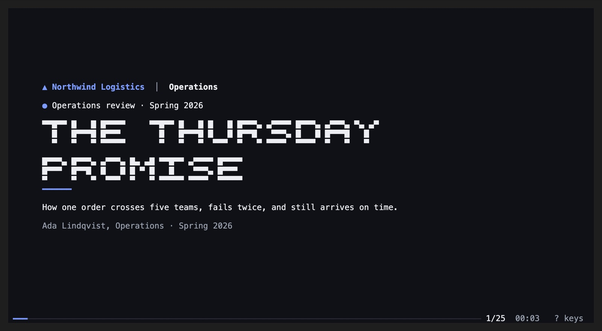
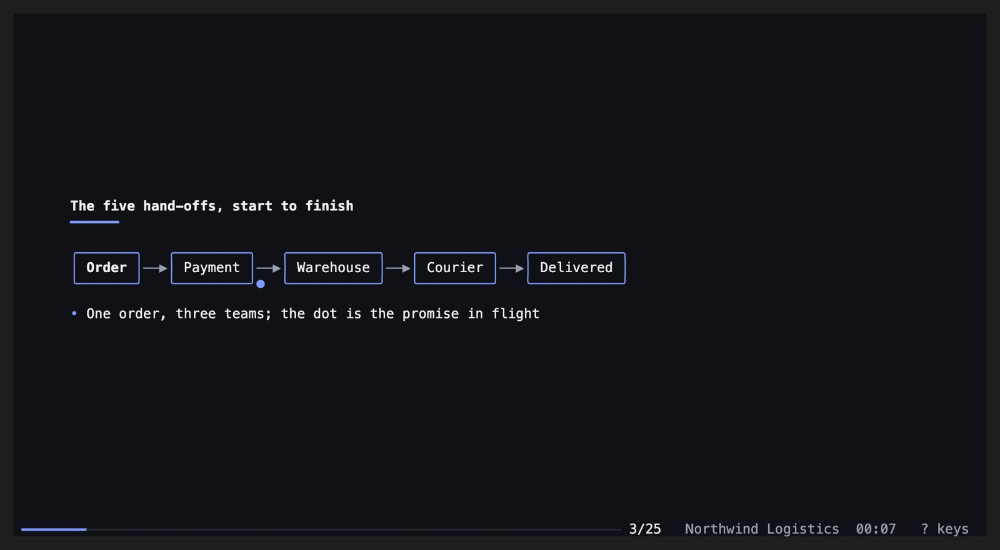
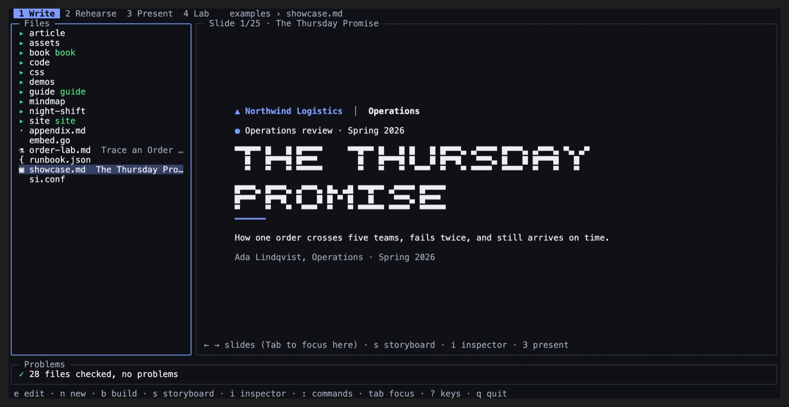

# Terminal

Everything you present in a browser, in a terminal: on a server over SSH, in
tmux, on a machine with no desktop, or simply because you live there. The
same deck, drawn with text and colour from its theme.

```bash
si play talk.md --terminal               # present
si play talk.md --terminal --notes       # the teleprompter, in a second terminal
si --terminal .                          # the Studio as a keyboard app
```



## Present

Titles in block letters, builds, every layout, code, tables, cards, badges and
logos. An animated canvas draws its boxes and wires on the character grid and
moves: a dot rides its route, parts ease to their new place between builds.



| Key | |
|---|---|
| → Space `n` | next build or slide |
| ← `p` | back |
| `g` / `G` | first / last |
| `o` | overview |
| `t` | restart the timer |
| `?` · `q` | keys · quit |

Pictures are real pictures in Kitty, Ghostty, WezTerm and iTerm2, and
half-block pixels anywhere else, tmux included. Resize the terminal and the
slide reflows; save the file and it reloads.

## The teleprompter

`--notes` in a second terminal (or a tmux pane) shows your `Notes:` script
with its `[CLICK]` cues, the timers and pace, now and next, and scrolls on its
own (`a`, `+`, `-`). It follows the presenter, and it can follow the same deck
open in a browser too.

## The Studio, as a keyboard app

`si --terminal .` is the twin of the web [Studio](studio.md): your files with
their kinds and titles, the live preview, and the problems of `si check`.



| Key | |
|---|---|
| `1` `2` `3` `4` | Write, Rehearse, Present, Lab |
| `e` | edit in your `$EDITOR` (in tmux, in a pane beside, so the preview follows every save) |
| `n` · `b` | a new file from a starter · build the folder |
| `s` · `i` | storyboard (minutes, layouts, builds) · inspector (layout, transition, background) |
| `:` or Ctrl+K | files and commands, fuzzy |

A mind map edits right in the preview: ↑ ↓ pick a topic, Enter renames it,
`c` adds a child, `o` a sibling, `x` deletes, `[` `]` reorder, `>` puts it
under the topic above, `<` takes it out a level, `u` undoes.

**Lab** (`4`) lists the deck's commands (its runbook and demo scripts) beside
a shell: in tmux a pane below, where Enter types a command and `x` runs it.

## The rules

- [14. Presenting: keys, touch, overview, print](../rules/14-presenting-keys-touch-overview-print.md)
- [11. Speaker notes and the teleprompter](../rules/11-speaker-notes-and-the-teleprompter.md)
