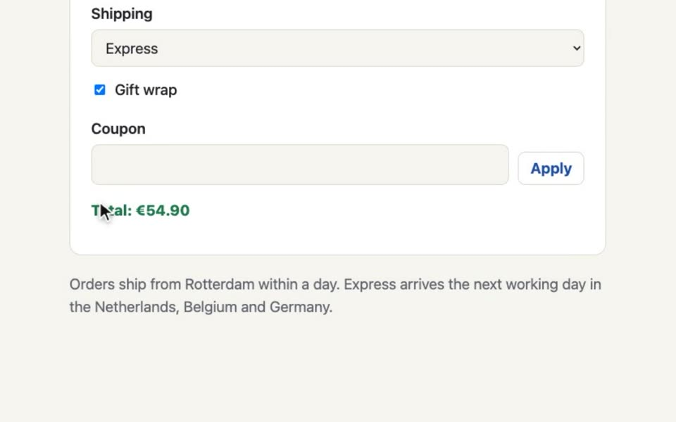
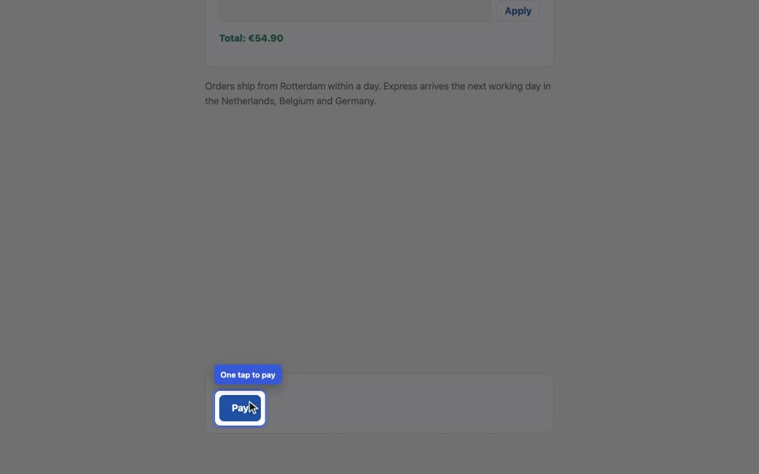

# Web demos

A web demo is a demo script with an `app:`. Each `##` is a feature of your
web app; under it, the steps a person would take, and what the page should
show. `si demo test` performs them in headless Chrome and tells you, step by
step, what passed and what broke; `si demo run` performs them on film and
narrates them, one video per feature and one with chapters.

```markdown
---
type: demo
title: Northwind Shop, from sign-in to receipt
app: app                # a URL, or the app's folder next to the script
viewport: desktop
---

## Pay for an order

What it does: a customer picks Express shipping and pays with a card.

Say: Sign in with the demo account.
- go /
- type "demo" into "Username"
- type $SHOP_PASSWORD into "Password"
- click "Sign in"
- expect text "Welcome back, demo"

Say: A test card goes through in a second.
- click "Order #4711"
- select "Express" in "Shipping"
- check "Gift wrap"
- click role=button "Pay"
- type "4242 4242 4242 4242" into "Card number"
- click "Confirm"
- wait for "Paid"
- expect url /receipt.html?order=4711
- expect no errors
```

Steps name elements the way you would say them: `click "Sign in"` finds the
button that reads Sign in, `type … into "Username"` the field labelled
Username. When the text is not enough, `#id`, `[data-testid=pay]` and
`role=button "Pay"` are there too. Clicks are real mouse clicks at the
element's centre, typing goes through the keyboard, and every step waits a
few seconds for the page to catch up before it gives up.

Secrets stay out of the script: `$SHOP_PASSWORD` comes from the environment
and shows as `$SHOP_PASSWORD` (or `••••`) in every line si prints.

## Run it

```bash
SHOP_PASSWORD=shop-demo si demo test shop.md
si demo test shop.md --feature "Pay for an order" --junit junit.xml
```

```text
Pay for an order
  ✓ type "demo" into "Username"  0.01s
  ✓ type $SHOP_PASSWORD into "Password"  0.01s
  ✓ press Enter  0.06s
  ✓ click "Order #4711"  0.07s
  ✓ select "Express" in "Shipping"  0.00s
  ✓ check "Gift wrap"  0.01s
  ✓ expect text "Total: €54.90"  0.00s
  ✓ click "Confirm"  0.07s
  ✓ wait for "Paid"  0.61s
  ✓ expect url /receipt.html?order=4711  0.00s
  ✓ expect no errors  0.00s
si demo: 3 passed, 0 failed in 4.6s; report: demo-out/shop/report.html
```

Every feature runs in a fresh browser, after the script's `setup:` command if
it has one, so one feature never leans on what the last one left behind.
`si demo test` exits 1 when anything failed, and `--junit` writes the JUnit
XML that GitHub Actions, GitLab and Jenkins read.

## When a step fails

The feature stops there, and the report says what the step expected, what
it found, the elements that came closest, and shows the page at that moment,
with the console errors and failed requests up to then.


`report.html` is one page with the screenshots inside, so it travels as an
attachment or a CI artifact; `report.json` has the same for your own tools.

## The script

- Markdown, AsciiDoc, or JSON for tools (the same features, blocks and
  steps).
- `app:` is a URL, or a folder: si serves the folder itself on this computer
  only, so a static app needs no server at all.
- `viewport:` `desktop` (1440×900), `tablet`, `phone` or `1280x720`;
  `timeout:` how long a step waits (5 s by default).
- `si check` knows every step, points at a bad one by its line, and warns
  when a `$VAR` is not set.

The example is a small shop in `examples/webdemo/`: `shop.md` signs in, pays
for an order and searches the order list; `broken.md` tries a spring coupon
that the shop does not know.

## On film

```bash
SHOP_PASSWORD=shop-demo si demo run shop.md
```

The same steps, filmed in a browser you never see. A drawn cursor glides to
each button and a ripple marks the click; `note "Username: demo" at
"Username"` puts a bubble beside the field until the narration moves on; text
is typed at a person's pace, and a field typed from a `$VAR` is blurred.


**The words set the pace.** Every `Say:` line is voiced before the take and
measured; the steps under it are spread over its words, and a block whose
steps need longer waits for them, so there is no dead air and no voice
talking over the wrong screen. A step that fails ends that feature's clip
there and goes into the report.

You get one file, `demo-out/shop/shop.mp4`: every feature after a title card,
picture and voice, a chapter each. The rest is there when you ask for it,
with `--with` (a comma list; `with:` in the script or `demo.with:` in si.conf
sets your usual):

| `--with` | Writes |
|---|---|
| `captions` | `shop.captions.mp4`: picture, voice and captions in a band under the picture |
| `silent` | `shop.silent.mp4`: the picture alone, no sound |
| `audio` | `shop.m4a`: the narration alone |
| `subtitles` | `shop.srt` · `shop.vtt`: captions, timed (SubRip, and WebVTT for the web) |
| `transcript` | `shop.txt`: what each feature says, as prose |
| `chapters` | `chapters.txt`: `0:00 Sign in` lines for a YouTube description |
| `clips` | the same per feature: `pay-for-an-order.mp4`, and its `.captions.mp4`, `.silent.mp4`, `.m4a`, `.srt`, `.vtt` when asked for |
| `report` | `report.html` · `report.json`: the run, linked to the videos |
| `readme` | `README.md` · `README.html`: the files, the video in the page with its captions track, the script, how it was made |
| `all` | everything above |

```bash
si demo run shop.md --with captions,subtitles,clips
```

Every video comes from one take, and only what you ask for is made. In the
captions video the picture shrinks into the top of the frame and the captions
sit in a dark band under it, so they never hide the command just typed.
`--viewport phone` films the phone layout; `--feature "Pay for an order"`
films one feature.

To film one part of the app instead of the whole page, crop to an element:
`--region ".agents-panel"` (or `region:` in front matter, or a `Region:` line
under one feature), or a fixed box with `--crop 0,80,1200,700`. The cursor,
clicks and notes still play; only the picture is cropped, and the whole run's
video letterboxes the cropped clips so they join.

**Long waits play faster.** A command that runs for a while, a program
starting, a wait for some output: after its first 3 s the video plays it
faster (it lasts 2 s at most) with a ⏩ badge in the corner. The voice is
never sped up, and the captions and chapters follow the shorter video.
`--fast-forward 5s` changes the 3 s; `--no-fast-forward` keeps every wait as
it was.

## With a terminal

Many apps are a terminal and a web page together: start a broker, send it a
message, see the message in its console. The script can start programs in
the background, type commands into a real terminal on camera, check what
they print, and go back to the browser.

```markdown
---
type: demo
title: A message broker, from the terminal to its console
app: http://127.0.0.1:7310
start: go run ./broker serve --port 7310 as broker · wait for port 7310 · within 120s
---

## Send a message from the terminal

What it does: a client sends one message, and the console shows it waiting.

Say: From a terminal, we send the broker one message.
- terminal "Client" · backdrop=ocean
- run "go run ./broker send hello from the terminal" · wait
- expect output "sent 1 message"
- note "One message, sent" at line "sent 1 message"

Say: The broker's console shows it, waiting in the queue.
- browser
- expect text "1 message waiting"
```

`start:` runs the broker before the first feature and waits until its port
answers (or until its output shows a text, `· wait for "ready"`). `terminal
"Client"` opens a shell in the script's folder, framed like a code window:
`window=mac`, `theme=dusk`, `backdrop=ocean`, `title="…"`, `size=100x30`.
`run` types the command at a person's pace and presses Enter; `· wait` waits
for it to end and fails on a non-zero exit. `expect output` checks what it
printed since, colours aside; `press ctrl+c` stops a program on camera;
`note "…" at line "…"` points at a line.

Sometimes the failure is the point: `run "si check bad.md" · exit 1` passes
only when the command exits 1 (`· fails`: any non-zero status), and an
`expect output "problem"` after it shows the error the viewer should read.
A command that succeeds there fails the step.


A workload for one feature is `start "go run ./broker load" as load · wait
for "sending"`; `stop load · wait` lets it finish, `expect load exited 0` and
`expect output of load "sent 30 messages"` check it, and the console's
counter climbs on screen meanwhile. Programs live for the whole run
(`start:`, with `stop:` to tear down), one feature (a `start` step), or a few
blocks (`start` … `stop`).

Nothing is left behind: every program runs in its own process group and is
stopped (SIGTERM, then SIGKILL after 5 s) when its feature or the run ends,
passed or failed, and on Ctrl-C. Its output goes to `<name>.log` beside the
report, secrets masked; a failure shows the terminal's last 40 lines in the
report and in JUnit. The example `examples/webdemo/broker.md` starts a tiny
broker written in Go with `go run`, so CI runs it too.

## Edited like a video

A demo film cuts where the scene changes: a `go` that loads a page, a switch
to a terminal or back, a popup, the next feature's title card. Each of those
cuts fades in 0.4 s, and while a page loads the last frame holds, so there is
never a blank page on screen. `transition: slide 0.6s` in front matter
changes every cut of the script (`cut` brings the hard cuts back), and one
step can pick its own:

```markdown
- go /order.html?id=4711 · fade
- terminal "Client" · pop
- browser · wipe
```

The names are `cut`, `fade`, `slide` (and `-left`, `-right`, `-up`,
`-down`), `wipe` (the same four), `pop`, `zoom` and `circle`, which opens
from the cursor. They are drawn from the take's frames when the video is
encoded, so the narration, the captions and the chapters keep their times.

The camera can move in on what the narration is about:

```markdown
Say: Order 4711 is still waiting for payment.
- select "Express" in "Shipping"
- check "Gift wrap"
- zoom to #total

Say: Help is one question mark away.
- zoom out
- hover "Help"
```



`zoom to` glides to the element with a margin and stays, `pan to` glides
across at the same zoom, `zoom out` comes back, and `· 1.2s` sets how long
the move takes. With a region, the camera stays inside it; `Region: ".agents"
· zoom` opens a feature on the whole page and then zooms into the region.

A spotlight dims the rest of the page around one element:

```markdown
Say: Pay sits at the bottom, under the delivery promise.
- scroll to [data-testid=pay]
- spotlight [data-testid=pay] · label "One tap to pay"
- click role=button "Pay"
```



The dark layer fades in and the cut-out closes from the whole screen onto the
element, then follows it; `· circle` makes it round, `· blur` blurs the page
instead of darkening it, `· for 3s` ends it early, and it ends with its
`Say:` block or at `spotlight off`. `focus` is the same step.

Two more steps reach what a click cannot. `window "si-presenter"` films a
popup or a tab the app opened, si's own teleprompter for one, and `window
main` comes back. `drag from "Shop" to "Doorstep"` (or `from 400,300 to
900,420`, or `by 300,80`) presses, moves and lets go with the drawn cursor,
enough to draw a stroke on a slide or move a topic on a map.

## si's own demos

The videos on this site are web demos too: six scripts in
[`docs/demos/`](https://github.com/felipeg48/simple-ideas/tree/main/docs/demos)
drive si in a terminal, a browser and the Studio. Every push checks them with
`si demo test`; every minor release films them with the Kokoro voice. They are
a good place to see terminals, background programs and the Studio in one
script.

## Voices

```markdown
voice: kokoro:af_heart
pronounce: si = ess eye
```

| Engine | What |
|---|---|
| `kokoro` | open source and local, natural: si's own voice, `af_heart` (the default when it is installed) |
| `system` | the computer's own: `say` on macOS, espeak-ng on Linux, the voices Windows has |
| `elevenlabs` | cloud, an API key; `elevenlabs:<voice id>` |
| `openai` | cloud, an API key; `gpt-4o-mini-tts`, with `voice-style: calm, friendly` |

`pronounce:` changes what the voice says (Kokoro reads "si" as "see"); the
captions keep the written word. Every line is cached by its words and voice,
so a re-run only voices the lines that changed, and a cloud voice is sent
nothing but the `Say:` text.

Kokoro installs in one command and changes nothing else on the computer (a
Python venv, `kokoro-onnx` and the two model files, checked by SHA-256, in the
folder `si doctor` names; it needs Python 3.10 to 3.13):

```bash
si voice install kokoro
si voice say "Every order, one journey" --voice kokoro:bf_emma
si voice list kokoro
```

`si voice say` speaks the line aloud like macOS `say` (`-o line.wav` saves
it). The cloud voices need an API key; keep it out of the project:

```bash
si voice login openai        # asks without echo; stored in your own si.conf, 0600
si voice logout openai
```

A key goes only in your own si.conf (in the user config folder), never in a
project's si.conf, which goes to git: si ignores one there and `si check`
says where. `OPENAI_API_KEY` and `ELEVENLABS_API_KEY` in the environment
still win. Your default voice and tone go in either si.conf:

```
voice: kokoro:af_heart
voice.style: calm, friendly
```

`--voice` wins, then the script's `voice:`, then the project's si.conf, then
yours.

<!-- si-deps: chrome ffmpeg kokoro espeak-ng -->

## The rules

- [27. Web demos](../rules/27-web-demos.md)
- [22. Demo scripts](../rules/22-demo-scripts.md)
