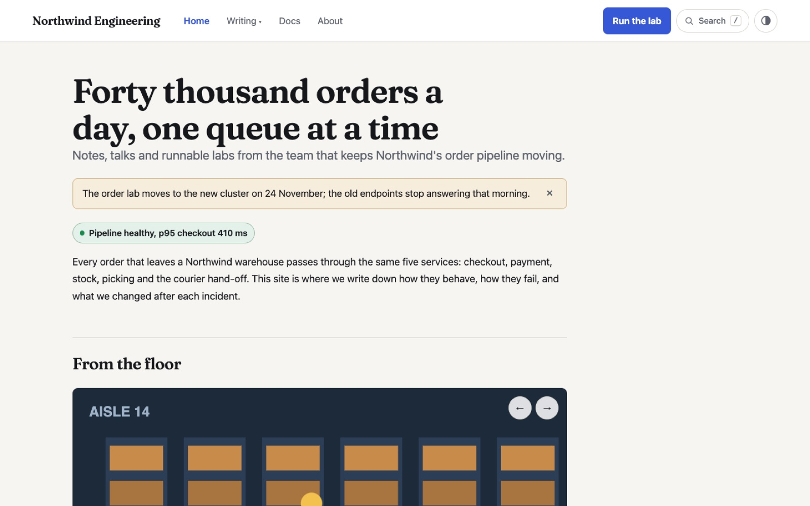
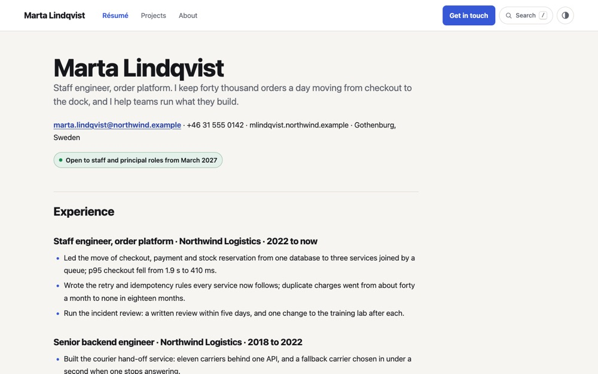
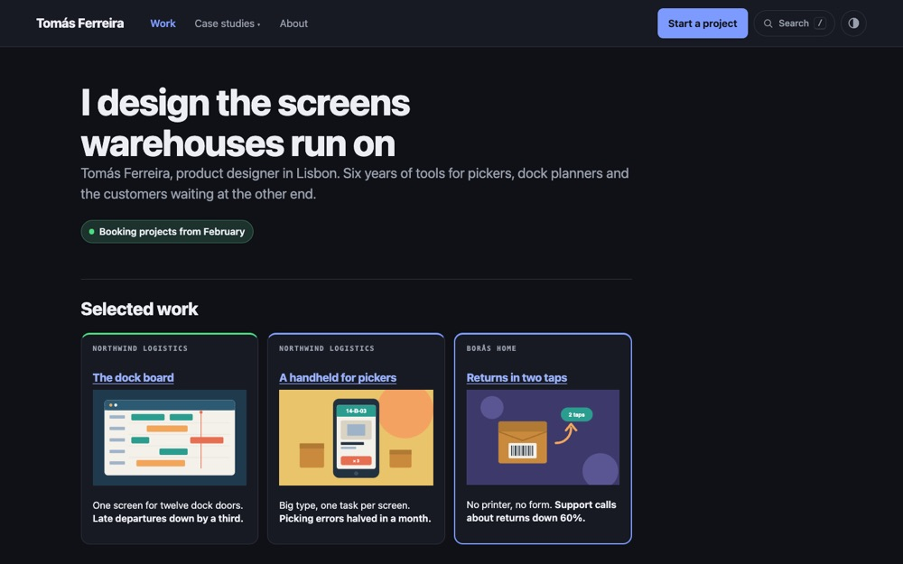
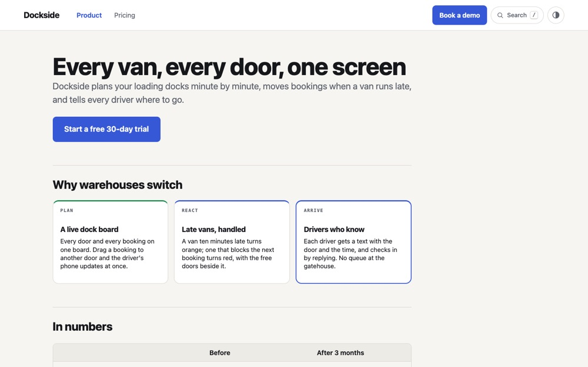
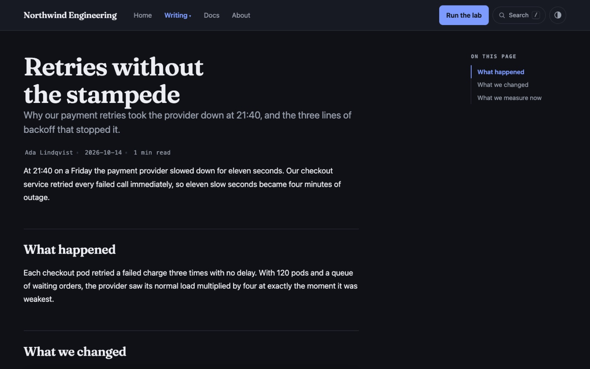
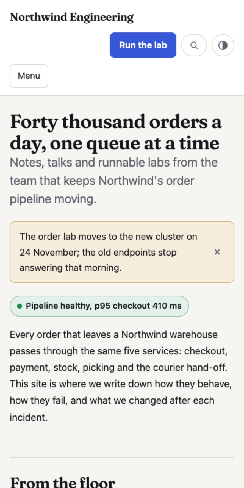

# Website

A folder of Markdown files becomes a website: a top bar with your logo and
menu, pages, blog posts, talks and whole guides inside it, search, light and
dark. `si build` writes plain HTML files you can put on any web host (GitHub
Pages, Netlify, a bucket, a USB stick).

```bash
si new mysite --type website     # mysite/ with _site.md, a home and an about page
si play mysite                   # preview it live, reloads on save
si build mysite -o out/          # the site as HTML, ready to upload
```



## Start from a kind

Three starters come with real content, ready to replace with yours:

```bash
si new marta --type website --kind resume       # or simply --type resume
si new tomas --type website --kind portfolio
si new dockside --type website --kind landing
```

**Résumé.** One page with your name, contact lines, experience, skills and
education that prints cleanly on A4 or Letter, plus a projects page and an
about page.



**Portfolio.** A home with a card per project, each with a picture and a
linked title, a case study per project, and an about page.



**Landing page.** A hero with its own button (a page's `cta:`), features as
cards, results as a table, questions as an accordion, a QR code, a demo
dialog and a pricing page.



The Studio's **New…** dialog and start gallery offer the same three.

## The folder

```
mysite/
  _site.md          the menu and the look
  index.md          Home
  about.md
  blog/retries.md   type: article: a byline and a contents column
  talks/journey.md  type: deck: a talk, built as slides
  docs/_nav.md      a guide inside the site, with its own sidebar
```

`_site.md` is front matter plus the menu, a nested list:

```markdown
---
title: Northwind Engineering
description: How Northwind Logistics moves forty thousand orders a day.
navigator: topbar
logo: Northwind Engineering
cta: Run the lab → docs/index
theme: studio
---

- [Home](index.md)
- Writing
  - [Retries without the stampede](blog/retries.md)
  - [The order journey, the talk](talks/journey.md)
- [Docs](docs/)
- [About](about.md)
```

Add a page by writing its file and a menu line; `si new post --type article`
inside the folder adds the line for you.



## The look

| Key | What |
|---|---|
| `navigator:` | `topbar` (logo left, menu, a button right), `topbar-centred`, `mega` (sections open as wide panels) or `sidebar` (a column on the left); on a phone every navigator folds into a **Menu** button |
| `logo:` | your name, a picture, or both: `logo: brand/mark.svg Northwind` |
| `cta:` | the highlighted button: `Label → page` or `→ https://…` |
| `unlisted: true` | on a page: built and linkable (from `cta:`, the footer or another page) but kept out of the menu, like a "Talk to us" page a button opens |
| `theme:` · `fonts:` | any theme, light and dark, and your own fonts |
| `favicon:` · `og-image:` | the tab icon and the picture link previews show |
| `footer:` | your footer, or a `_footer.md` with links |

Pages use everything else si has: cards, badges, alerts, accordions, tabs,
carousels, code, mind maps, QR codes and embedded talks.



[See the whole example on GitHub](https://github.com/felipeg48/simple-ideas/tree/main/examples/site),
or this very site: simple-ideas.org is built with si.

<!-- si-deps: -->

## The rules

- [23. Sites](../rules/23-sites.md)
