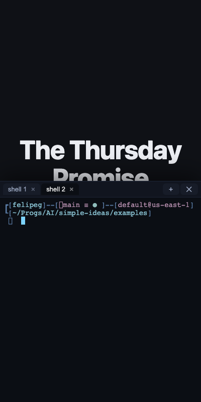

# Terminal drawer — `si play` presenter terminal (shipped, v0.6.0)

A HUD drawer that slides up from the bottom of a `si play` deck to run **local**
commands live during a demo, without leaving the slides. Press **`` ` ``**
(backtick) to toggle it.

Built in v0.6.0. This note is the reference; the original brief is preserved in
the git history of this file.

## What it does

- A dark, monospace drawer (~55vh) over the current slide, with a **tab bar**:
  multiple concurrent shells (tab 1 runs `cockroach start-single-node`, tab 2
  runs `cockroach sql`, tab 3 runs `docker ps`). `+` opens a tab, `×` closes one,
  `✕` hides the drawer.
- Each tab is a **real shell** (`$SHELL`, falling back to `/bin/sh`) running under
  a **PTY**, started in the deck's directory. Because it is a true PTY, Ctrl-C,
  arrow keys, REPL prompts (`cockroach sql`), and full-screen apps all work — the
  bytes travel straight through; `si` never parses commands.



## Why it is a documented exception to the project rules

It deliberately relaxes two non-negotiable rules **for this subsystem only**:

- **Rule #7 (Go stdlib + goldmark only):** adds `github.com/creack/pty` and
  bundles `xterm.js` + the fit addon (vendored under
  `internal/assets/web/term/`).
- **Rule #2 (self-contained output):** the drawer loads `xterm.js` from the
  `si play` server.

Both are contained because the terminal is **`si play` only + loopback only**
(see Security). A built, static `.html` has no server, so `SI_CONFIG.terminal`
is `false`, `deck.js` never loads a byte of terminal code, and none of this
ships in a deck file. The terminal CSS lives inside `term.js` (not in the themed
`layout.css` / `theme.css`), so it stays outside the `--si-*` / `.si-*` styling
contract — a terminal is always dark and monospace regardless of the deck theme.

## Security (non-negotiable, enforced)

- **Loopback only.** `main.go` sets `Server.Terminal = true` only when the listen
  address is loopback (`ta.IP.IsLoopback()`). On `--addr 0.0.0.0` (phone/QR mode)
  or any reachable IP it is `false`, so the exec routes are **never registered**
  and can never become LAN remote-code-execution. `TestTerminalDisabledByDefault`
  guards this.
- **Opt-out flag.** `feature.terminal: off` in `si.conf` hides the drawer even on
  loopback. Default on.
- Shells are killed on tab close and on server shutdown (`CloseTerminals`).

## How it is wired (end to end)

| Layer | File | What |
|---|---|---|
| PTY sessions | `internal/serve/terminal.go` | `termHub`: tab-id → `{pty, cmd}`; `newTab` starts a shell in a PTY; `out`/`in`/`resize`/`close` endpoints |
| Routes (gated) | `internal/serve/serve.go` | registers `/_si/term/api/*` + static `/_si/term/assets/*` only when `s.Terminal` |
| Capability | `cmd/si/main.go` | `srv.Terminal = ta.IP.IsLoopback()` after `net.Listen` |
| Page flag | `internal/render/render.go` | `Options.Terminal` → `SI_CONFIG.terminal` (false for build/export) |
| Config | `internal/config/config.go` | `keys.terminal` (`` ` ``) + `feature.terminal` |
| Lazy hook | `internal/assets/web/deck.js` | on `` ` ``, lazy-loads the runtime, then `window.siTerm.toggle()` |
| Drawer UI | `internal/assets/web/term/term.js` | tabbed xterm drawer; styles self-contained |
| Vendored | `internal/assets/web/term/` | `xterm.js`, `xterm.css`, `addon-fit.js` |

## Transport (the open decision, decided)

Go stdlib has no WebSocket, and we did not add one. Output streams over a
**chunked GET** (`/_si/term/api/out?id=`), read on the client with
`fetch().body.getReader()` and fed to `term.write()` as raw bytes; input is a
**POST** body per `onData` (`/_si/term/api/in?id=`); resize is a POST with
`cols`/`rows`. One stream per tab. This keeps the new-dependency count at exactly
one (`creack/pty`) plus the bundled xterm.

## Process lifecycle (decided)

- One PTY-backed `$SHELL` per tab; cwd = deck dir; env inherited (+ `TERM=
  xterm-256color`).
- Ctrl-C needs no special endpoint: xterm sends `0x03` as input → the PTY delivers
  SIGINT to the foreground process naturally.
- A tab's shell is killed on close; all shells are killed on `si play` shutdown.

## Ideas not yet built

- Persist/restore tab layout across reloads.
- A visible "running" indicator per tab.
- Remote (non-loopback) is intentionally out of scope and stays that way.

## Runbook drawer (shipped, v0.7.0)

A right-hand drawer in the terminal HUD: a command cheat-sheet that types into the
active shell. Opt in with front matter `runbook: <path>.json` on the deck.

- **Source of truth.** The JSON shape matches the cockroach-engineering-tool VS
  Code extension's `runbook.json` (`{ categories: [ { name, icon, entries: [ {
  label, description, command, target } ] } ] }`), so an exported runbook drops in
  unchanged. `command` is canonical; `sql` is accepted as an alias. `target`
  (`sql` | `bash`, default `sql`) picks the highlighter.
- **Highlighting is server-side.** `render` runs each command through the same
  highlighter the code fences use and injects `window.SI_RUNBOOK` with both the
  raw command (`cmd`, sent to the PTY) and pre-highlighted HTML (`html`, shown in
  the drawer). No JS highlighter port. The `si-tk-*` token colours are restyled
  dark inside `.si-rb` so the drawer stays legible regardless of the deck theme.
- **Interaction.** A filter box; click an entry to *type* the command into the
  active tab (via the existing `POST /in` input path), Shift/⌘-click to type **and**
  run (append `\r`). The drawer defaults open when a runbook is present; the
  open/closed state is persisted (`localStorage`).
- **Containment.** `window.SI_RUNBOOK` is injected only when `opt.Terminal` is set
  — i.e. `si play` on a loopback address. A built deck never carries it, so rules
  #2/#7 hold for shipped HTML exactly as they do for the terminal. `si check`
  still parses and validates the runbook path (it renders without `Terminal`), so a
  bad path or malformed JSON is caught at check time.
- **Code.** Parse + highlight: `internal/render/runbook.go`. Front-matter key:
  `deck.Meta.Runbook`. Drawer UI + token CSS: `internal/assets/web/term/term.js`
  (same file as the terminal, same styling-contract exemption).

### Placeholders (v0.9.0)

A command may hold `{{name}}` or `{{name:default}}`. Clicking the entry opens an
inline form in the drawer with one field per distinct name, prefilled with the
value used earlier this session (`sessionStorage` key `si-rb-vars`), else the
default. Enter types the command, Shift/Cmd/Ctrl+Enter types and runs, Esc
cancels and types nothing. Placeholders show highlighted in the entry; other
braces (`{{.Names}}`, `${HOME}`) are typed verbatim. A top-level `name` in the
runbook is the drawer title. Studio can edit and generate runbooks (see
`docs/studio.md`).

### Ideas not yet built (runbook)

- Hot-reload the runbook file in `si play --dev` (today a reload picks up edits).
- Markdown runbook authoring (`## Category` + titled ` ```sql ` fences) as an
  alternative to JSON.
