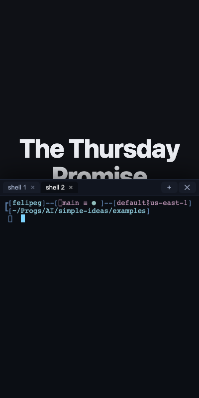

# Terminal drawer — `si play` presenter terminal (shipped, v0.6.0)

A HUD drawer that slides up from the bottom of a `si play` deck to run **local**
commands live during a demo, without leaving the slides. Press **`` ` ``**
(backtick) to toggle it.

Built in v0.6.0. This note is the reference; the original brief is preserved in
the git history of this file.

## What it does

- A dark, monospace drawer (~55vh) over the current slide, with a **tab bar**:
  multiple concurrent shells (tab 1 runs `postgres -D data`, tab 2
  runs `psql`, tab 3 runs `docker ps`). `+` opens a tab, `×` closes one,
  `✕` hides the drawer.
- Each tab is a **real shell** (`$SHELL`, falling back to `/bin/sh`) running under
  a **PTY**, started in the deck's directory. Because it is a true PTY, Ctrl-C,
  arrow keys, REPL prompts (`psql`), and full-screen apps all work — the
  bytes travel straight through; `si` never parses commands.



## Why it is a documented exception to the project rules

It deliberately relaxes two non-negotiable rules **for this subsystem only**:

- **Rule #7 (Go stdlib + goldmark only):** adds `github.com/creack/pty` and
  bundles `xterm.js` + the fit addon (vendored under
  `internal/assets/web/term/`).
- **Rule #2 (self-contained output):** the drawer loads `xterm.js` from the
  `si play` server.

Both are contained because the terminal is **`si play` only + loopback only**
(see Security). A built, static `.html` has no server, so `SI_CONFIG.terminal`
is `false`, `deck.js` never loads a byte of terminal code, and none of this
ships in a deck file. The terminal CSS lives inside `term.js` (not in the themed
`layout.css` / `theme.css`), so it stays outside the `--si-*` / `.si-*` styling
contract — a terminal is always dark and monospace regardless of the deck theme.

## Security (non-negotiable, enforced)

- **Loopback only.** `main.go` sets `Server.Terminal = true` only when the listen
  address is loopback (`ta.IP.IsLoopback()`). On `--addr 0.0.0.0` (phone/QR mode)
  or any reachable IP it is `false`, so the exec routes are **never registered**
  and can never become LAN remote-code-execution. `TestTerminalDisabledByDefault`
  guards this.
- **Opt-out flag.** `feature.terminal: off` in `si.conf` hides the drawer even on
  loopback. Default on.
- Shells are killed on tab close and on server shutdown (`CloseTerminals`).

## How it is wired (end to end)

| Layer | File | What |
|---|---|---|
| PTY sessions | `internal/serve/terminal.go` | `termHub`: tab-id → `{pty, cmd}`; `newTab` starts a shell in a PTY; `out`/`in`/`resize`/`close` endpoints |
| Routes (gated) | `internal/serve/serve.go` | registers `/_si/term/api/*` + static `/_si/term/assets/*` only when `s.Terminal` |
| Capability | `cmd/si/main.go` | `srv.Terminal = ta.IP.IsLoopback()` after `net.Listen` |
| Page flag | `internal/render/render.go` | `Options.Terminal` → `SI_CONFIG.terminal` (false for build/export) |
| Config | `internal/config/config.go` | `keys.terminal` (`` ` ``) + `feature.terminal` |
| Lazy hook | `internal/assets/web/deck/05-annotate-keys.js` | on `` ` ``, lazy-loads the runtime, then `window.siTerm.toggle()` |
| Drawer UI | `internal/assets/web/term/term.js` | tabbed xterm drawer; styles self-contained |
| Vendored | `internal/assets/web/term/` | `xterm.js`, `xterm.css`, `addon-fit.js` |

## Transport (the open decision, decided)

Go stdlib has no WebSocket, and we did not add one. Output streams over a
**chunked GET** (`/_si/term/api/out?id=`), read on the client with
`fetch().body.getReader()` and fed to `term.write()` as raw bytes; input is a
**POST** body per `onData` (`/_si/term/api/in?id=`); resize is a POST with
`cols`/`rows`. One stream per tab. This keeps the new-dependency count at exactly
one (`creack/pty`) plus the bundled xterm.

## Process lifecycle (decided)

- One PTY-backed `$SHELL` per tab; cwd = deck dir; env inherited (+ `TERM=
  xterm-256color`).
- Ctrl-C needs no special endpoint: xterm sends `0x03` as input → the PTY delivers
  SIGINT to the foreground process naturally.
- A tab's shell is killed on close; all shells are killed on `si play` shutdown.
- **Shells outlive the page (v3.6.0).** One goroutine per tab (`termSession.pump`)
  reads the PTY into a ring buffer (the last 256 KB, `ringMax`) and on to the
  attached stream. `out` attaches (the newest stream wins: an older one for the
  same tab ends, so no output is shown twice), first writes the ring (from a
  line start once it has wrapped) and, on a reattach, sends `X-Si-Replay: N`
  so `term.js` does not send xterm's answers to old terminal queries in those
  N bytes back to the shell. `GET /_si/term/api/list` returns `[{id, title,
  created}]`. A shell with no stream for `termHub.idle` (10 minutes) is closed
  by a once-a-minute `reap`; `TestTerminalReattach`, `TestTerminalIdleReap`.
- **The page side.** `term.js` writes `sessionStorage` `si-term-state` on
  `pagehide`: open or not, the active tab, and each tab in order (a shell:
  `{id, label, zoom}`; a Viewer: `t.snap()`, folder, file, edit mode with an
  unsaved draft and the mtime it began from, Follow, zoom, `open` (the tree's
  open folders) and `treeTop` (its scroll); since v3.14.0 `rows()` resolves
  once the open folders below it are listed, and `t.onShow` (called by
  `layout()` and when the tree is ready) sets the scroll once the pane is
  visible). `05-annotate-keys.js`
  loads the runtime on page load when that state has tabs; `term.js` asks
  `list`, attaches the live shells (dropping the ended ones), reopens the
  Viewers and selects the active tab without taking the deck's focus when the
  drawer was closed.
- **Text size per tab:** `t.zoom` (0.5-3): a shell's xterm `fontSize` is 14 ×
  zoom (refit, resize sent); a Viewer sets `--si-z` on its pane, which scales
  the tree, the read-only view and the CodeMirror editor. The bar's − % + and
  ⌘= / ⌘- / ⌘0 (a capture listener on the whole drawer, `preventDefault` +
  `stopPropagation`) act on the active tab; Chrome sends the zoom keys to the
  page first and does not zoom when it cancels them, which
  `web/studio/e2e/workbench.e2e.mjs` checks from the page's side
  (`defaultPrevented`, `devicePixelRatio` and `visualViewport.scale` unchanged;
  headless Chrome has no browser zoom of its own to observe);
  `localStorage` `si-term-zoom` / `si-fs-zoom` hold the default for new tabs.
- **Drawer height:** the top-edge grip sets `--si-term-h` in `vh` (20-100),
  `localStorage` `si-term-h`; `.is-max` (100vh) overrides it and gives it back.

## Ideas not yet built

- A visible "running" indicator per tab.
- Remote (non-loopback) is intentionally out of scope and stays that way.

## Runbook drawer (shipped, v0.7.0)

A right-hand drawer in the terminal HUD: a command cheat-sheet that types into the
active shell. Opt in with front matter `runbook: <path>.json` on the deck.

- **Shape.** The JSON is `{ categories: [ { name, icon, entries: [ {
  label, description, command, target } ] } ] }`. `command` is canonical; `sql` is accepted as an alias. `target`
  (`sql` | `bash`, default `sql`) picks the highlighter.
- **Highlighting is server-side.** `render` runs each command through the same
  highlighter the code fences use and injects `window.SI_RUNBOOK` with both the
  raw command (`cmd`, sent to the PTY) and pre-highlighted HTML (`html`, shown in
  the drawer). No JS highlighter port. The `si-tk-*` token colours are restyled
  dark inside `.si-rb` so the drawer stays legible regardless of the deck theme.
- **Interaction.** A filter box; each entry has **Copy** and **Run** buttons
  (clicking the entry is Copy, Shift/⌘-click Run). Copy puts the command at the
  prompt of the active tab (via the existing `POST /in` input path) and on the
  clipboard; Run also sends `\r`. The ready signal is bracketed-paste mode
  (`term.modes.bracketedPasteMode`), which zsh and bash 5.1+ turn on when the
  prompt is ready to edit: the text then goes in as `ESC[200~…ESC[201~`, so it
  shows whole (multi-line included) and runs only on Enter. If the tab has been
  ready before and the mode is off, a command is running and the text is typed
  into it. While the shell is still starting (a heavy `.zshrc` can print nothing
  for several seconds) the button shows "Waiting…" for up to 20 s; after 15 s a
  shell that never enables the mode (sh, macOS bash 3.2) gets plain keystrokes
  once quiet. (Before v0.9.3 a click during startup was echoed above the prompt
  and a multi-line command ran line by line.) The drawer defaults open when a runbook is present; the
  open/closed state is persisted (`localStorage`).
- **Containment.** `window.SI_RUNBOOK` is injected only when `opt.Terminal` is set
  — i.e. `si play` on a loopback address. A built deck never carries it, so rules
  #2/#7 hold for shipped HTML exactly as they do for the terminal. `si check`
  still parses and validates the runbook path (it renders without `Terminal`), so a
  bad path or malformed JSON is caught at check time.
- **Code.** Parse + highlight: `internal/render/runbook.go`. Front-matter key:
  `deck.Meta.Runbook`. Drawer UI + token CSS: `internal/assets/web/term/term.js`
  (same file as the terminal, same styling-contract exemption).

### Demos (v0.9.3)

Front matter `demos: ../demos/, extra.md` (files or folders, relative to the
deck; a folder gives its `*.md` except `README.md`, `index.md`, `_*`). `render`
(`internal/render/demos.go`) converts each script with goldmark (GFM, raw HTML
allowed: it is the presenter's own file, shown on loopback), highlights every
fence with the deck highlighter and marks shell-type fences (`bash sh shell zsh
console sql powershell ps1 pwsh fish`) `si-dm-run`; it injects
`window.SI_DEMOS = [{title, file, html}]` only with `opt.Terminal`. In the drawer
(`term.js`) the Demos icon in the tools bar (`.si-term-acts`, right edge) opens the panel (exclusive with the runbook): a
`<select>` of titles, the script as a dark document, and Copy / Run on every
`si-dm-run` block (the text sent is the block's `textContent`). The pick and the
open state persist (`localStorage` `si-demo-pick`, `si-demos-open`). A
`Full script` / `Commands only` button switches the view (`si-demos-view`;
default Commands only: `.si-dm-cmds` hides everything but headings with
commands (`.si-dm-bare` marks the rest) and the runnable blocks).

### Placeholders (v0.9.0)

A command may hold `{{name}}` or `{{name:default}}`. Clicking the entry opens an
inline form in the drawer with one field per distinct name, prefilled with the
value used earlier this session (`sessionStorage` key `si-rb-vars`), else the
default. Enter (or Copy) puts the command at the prompt, Shift/Cmd/Ctrl+Enter (or Run) also runs it, Esc
cancels and types nothing. Placeholders show highlighted in the entry; other
braces (`{{.Names}}`, `${HOME}`) are typed verbatim. A top-level `name` in the
runbook is the drawer title. Studio can edit and generate runbooks (see
`docs/studio.md`).

### Ideas not yet built (runbook)

- Hot-reload the runbook file in `si play --dev` (today a reload picks up edits).
- Markdown runbook authoring (`## Category` + titled ` ```sql ` fences) as an
  alternative to JSON.

## Browser windows (w)

`internal/serve/browser.go` + `internal/assets/web/term/web.js` (served from
the same `/_si/term/assets/`, lazy-loaded by `05-annotate-keys.js` on **w**, or
on load when `sessionStorage` `si-web` holds windows from before a live
reload). `POST /_si/browser/open {url}` (localOnly) starts, once per target
origin, an `httputil.ReverseProxy` on `127.0.0.1:0` that drops
`X-Frame-Options` and CSP `frame-ancestors`, keeps redirects on the proxy and
strips `Domain`/`Secure`/`SameSite` from cookies; the window frames the
proxied URL. Links come from the `browser:` front matter as
`window.SI_BROWSER` (play terminal only); recent addresses in `localStorage`
`si-web-recent`. Proxies close with the terminals.

Back and forward (v3.6.0): the deck cannot reach a cross-origin frame's
history, so the proxy asks upstream for a plain body (no `Accept-Encoding`)
and `injectNav` puts a small script after `<head>` of every HTML response
(dropping its CSP so the inline script runs). The script posts `{si:'nav',
kind, url, title}` to the parent on load, `pushState` / `replaceState`,
`popstate` and `hashchange`, and obeys `{si:'nav-cmd', cmd:'back'|'forward'|
'reload'}` from the parent only. `web.js` accepts nav messages only from each
window's own frame (`ev.source`), maps the proxy origin back to the real one
for the address box, and keeps a per-window list of addresses and a position
(a new address after a back drops the ones ahead) to dim ← and →.
`TestBrowserProxyInjectsNav`.

Across sites (v3.11.0): the injected script carries the page's real origin
(`T`) and reports `real` (the real address) with each nav message, so the
address box is right on any proxy. A click on a link to another http(s)
origin is cancelled in the page and posted as `{si:'nav-open', url}`; the
window opens it through `/_si/browser/open` (that origin's proxy, started
once) as a new frame address, so the frame's history (← →) spans the sites.
A redirect's absolute `Location` is rewritten by `through`: the same proxy
for its own origin, another origin's proxy (started then) for any other
http(s) origin; a relative `Location` stays. Script navigations (v3.14.0):
`navScript` also wraps `window.open` (a cross-origin address is posted as
`nav-open`, `null` returned), cancels a GET form to another origin (its
fields as the query), and, where `window.navigation` exists, cancels any
other cross-origin `navigate` event (`location.assign`/`replace`,
`location.href =`, POST forms; not `traverse` or `reload`) and posts it.
`location`'s methods are unforgeable, so without the Navigation API those
still leave the proxy; a POST is reopened as a GET of its address, body
dropped.
`TestBrowserProxyAcrossSites`; `web/studio/e2e/browser.e2e.mjs` (two local
origins, headless).

## Web demo terminals: split

`si demo test|run` terminals (`internal/webdemo/term.go`, `termpage.js`)
reuse the pty and xterm.js, one keyed page per terminal. `terminal split
right|down` opens a second shell (`term.split` on the first pane, `root` on
the second) and calls `__siTermSplit(dir, {out, size})` on the same page:
the body becomes two `.si-term-pane`s (flex row or column), the first pane
refits and tells its shell the new size, the second streams its own output;
both are on the page the screencast films. `focus N` sets the pane `run`,
`press` and `expect output` go to (`__siTermFocus`, the other dims); `run …
in 2` picks a pane for one step. Two panes at most. On Windows the shells
are `cmd` on pipes, as for one terminal; ConPTY is not used.

## The public API: `window.siPlay` (v1, issue #13)

Web demos (`embed-terminal`, `embed-browser`, `slide N`, RULES §27), a
deck's `Notes:` cues (`[TERM Name: command]`, `[BROWSER Name]`, §11, played
by auto-play and filmed by `si build --mp4 --voice`) and tests drive the
drawer, the browser windows and the deck through one object the play page
defines, never through the markup (`.si-term`, `[data-act=…]`,
`.si-web-url` are not a contract and may change). Where it lives:
`internal/assets/web/deck/05-playapi.js` (only when `cfg.terminal`, i.e.
`si play` on a loopback address, and not a remote role), on top of
`window.siTerm.api` (`term.js`: tabs by label, `shellReady`, `typeOut`) and
`window.siWeb.api` (`web.js`: windows by link name or the name they were
opened with; the iframe carries `data-si-window`). Lazy loading stays:
the first call loads xterm.js / term.js or web.js (callbacks queue while a
load is in flight). The full table of calls is in RULES §14;
`internal/webdemo/embed_e2e_test.go` pins it (`TestPlayAPIContract`: the
shape, version 1, and what each call does against a real `si play` server
and a local fake console).

- `terminal.open(name, {split})` resolves once the tab's shell has printed
  and gone quiet (80 ms with bracketed paste, 250 ms without, or after 3 s
  of continuous output); `run` pastes (bracketed where the shell has it),
  `{typing: ms}` types; `type` sends keys raw; `output` reads the xterm
  buffer, wrapped lines joined.
- `browser.open(name, {x, y, w, h, zoom})`: a link name, else anything with
  `/`, `.` or `:` is a URL (refused otherwise); resolves on the frame's load.
- `slide(n, step)`, `next()`, `prev()`, `at()`: the runtime's own `go`,
  `forward`, `backward` (same as `window.SI`).
- `act(cues)`: `deck.Act` objects (`{tool, name, cmd, state}`), in order.

When a demo's `app:` is a `.md` deck, `si demo` adds `exec si play <deck>
--addr 127.0.0.1:<free port>` (`SHELL=` from `shell:`) at the front of the
`start:` programs (`internal/webdemo/embed.go`, `playDeck`; `Options.SIBin`
names the binary, else `os.Executable`), so it is stopped and logged like
any program. `si build --mp4` of a deck with cues serves it in-process
(`cmd/si/motion.go`, `playForFilm`, terminal on, loopback) and films each
view holding cues as it plays (`filmActs`), at the time the voiced script
reaches them.

## Viewer tabs

The Viewer icon (`term.js` `newViewer`): a tab `{viewer: true, pane, tabEl}` in the
same strip as the shells (select/close/resize skip xterm for it; `lastShell`
is where Run and ⌂ Shell go):
`GET /_si/term/api/ls?dir=` (folders first; 2000 entries), `cat?path=`
(first MB, `render.Highlight` by extension, binary and image detection),
`raw?path=` (pictures only, SVG under a no-script CSP), `cwd?id=` (the tab
shell's folder: `/proc/PID/cwd` on Linux, `lsof -d cwd` elsewhere); all
`localOnly` (`internal/serve/files.go`). Relative paths start at the deck's
folder; `localStorage` `si-files-dir` (the last folder).

**Editing (v3.4.0).** `cat?edit=1` also returns `text` (only when the whole
file fit, is text and valid UTF-8) and always `mtime` (unix nanos as a
string). `POST /_si/term/api/save` `{path, text, mtime, force}` (`localOnly`,
so same-origin): 409 when the file's mtime differs unless `force`; writes a
temp file in the same folder and renames it over (the mode kept; a link's
target is the file rewritten); 5 MB at most; returns the new `mtime`. The
rename runs inside `Server.quietly`, which moves the live-reload watcher's
baseline, so a save never reloads the page (that would close the drawer, its
shells and the editor); a write from a shell still reloads.

The editor is `internal/assets/web/term/editor.js`, CodeMirror 6 bundled as
an IIFE from `web/studio/src/term-editor.ts` by `make studio-ui`
(`window.SiEditor.create(parent, {doc, file, onChange, onSave})` →
`{getText, setText, focus, destroy}`), about 730 KB (250 KB gzipped),
fetched only the first time **Edit** is pressed. Languages by file name
(`languageFor`): the `@codemirror/lang-*` parsers for JS/TS/JSX/TSX, JSON (+
`jsonParseLinter`), Markdown, CSS, HTML; `@codemirror/legacy-modes` for the
rest. Colours are the drawer's `.si-tk-*` ones. Syntax colouring and JSON
lint only, not a language server (LSP). Like xterm.js and the Studio, it is
play-only and loopback-only and never in a built deck. Leaving a dirty
editor (close, another file, Done) asks in a bar inside the pane
(`.si-fs-ask`), never `confirm()`.

**File operations (v3.5.0).** All `localOnly`, paths through `resolve`
(relative to the deck folder, `~` expanded); writes under the deck folder run
inside `quiet` (`termHub.change`), so they never live-reload the page.
`POST create {dir, name, folder}` (an empty file with `O_EXCL`, or a folder),
`POST rename {path, name}` (same folder; a case-only rename on macOS is
allowed), `POST delete {path}` (`Lstat`: a link is removed itself; a folder
with `RemoveAll`, which removes links inside and never follows them; `/` is
refused), `GET stat?path=[&count=1]` → `{mtime, size, dir, link, items}`.
A name is one path element (`validName`: no `/`, `\`, `.`, `..`, NUL, no
outer spaces) else 400; a taken name 409; a missing path 404. The tree
(`.si-fs-side`: `.si-fs-tb` toolbar over `.si-fs-tree`) keeps `holders[dir]`
(where a listed folder's rows are) and `opened` (folders shown open, kept
across a refresh), so an operation refreshes just its folder. Names are typed
in place (`nameInput`: Enter, Escape, blur cancels); the context menu
(`showMenu`, `.si-fs-menu`) lives on `document.body` because the drawer's
transform would offset a fixed menu inside it. Deleting asks in `.si-fs-ask`
with the stat's item count; Cancel has the focus.

**Colours for `.conf` (v3.5.0).** `render.Highlight` language `ini` (aliases
`conf`, `cfg`, `cnf`, `properties`, `gitconfig`, `editorconfig`, `npmrc`):
comments `c`, `[section]` `m`, key `v`, booleans `k`, numbers with a unit `n`,
strings `s`, URLs and paths `y`. The editor's `conf` stream mode in
`term-editor.ts` gives the same kinds (`propertyName`, `meta`, `keyword`,
`number`, `string`, `url`).

**Follow (v3.5.0).** The read-only view's **Follow** polls `stat` every
second while the tab is visible and the drawer open; on a new mtime or size it
reads `cat?edit=1&tail=1` (a file over 1 MB: its last MB from a line start,
`tail: true`, and `first`, the line number the window starts at) and keeps
the scroll at the end only if it was there; the view sets `counter-reset: ln
first-1` on its `<pre>`. `lineAt` (files.go) counts the newlines before the
window in 256 KB reads and keeps `{off, n, size, mtime}` per file in
`termHub.lines`: a file that only grew is counted on from the last offset,
a shrunk file (or the same size with a new mtime) is counted again. While
editing, the same poll shows a changed-on-disk notice once per mtime
(**Reload** / **Keep editing**); the editor is never refreshed under the
user. The live-reload watcher skips `*.log` files, so a log a demo writes in
the deck folder can be followed without reloading the deck.

## Split view, quick open, search, spotlight (v3.9.0)

**Split.** `split` in `term.js` is `null` or `{dir: 'right'|'down', rx, ry,
panes: [tab, …], focus}` (2 to 4 panes, v3.14.0; `focus` an index). No DOM
moves: every pane stays an absolutely placed child of `.si-term-main`;
`geometry()` gives each shown pane an `inset` from `rx` (the vertical divider)
and `ry` (the horizontal one): two panes side by side or stacked, three as one
big pane and two beside (or under) it, four a 2×2 grid; a drawer under 560 px
wide stacks them. `layout()` applies it, places `.si-term-div.v` and
`.si-term-div.h` and refits every shown shell (`refit()`). `select(i)` shows
a tab in the focused pane (or focuses the pane already showing it); a
`pointerdown` inside a pane focuses it. `splitOpen` opens a split or, already
split, adds a pane (Shift-click ◫, the tab menu, `siTerm.split('add')`).
Tabs are `draggable`; a drop on `.si-term-main` picks the pane under the
pointer (`paneAt`, `placeIn`, swapping when the tab was in another pane).
Closing a shown tab closes its pane (`unpane`; one left ends the split). The
reload state (`si-term-state`) carries `split: {dir, rx, ry, panes, focus}`
with tab indexes, mapped back on restore (the v3.9.0 `{ratio, a, b}` form is
still read). Keystrokes go to a shell one POST at a time (`sendIn`), so fast
typing cannot arrive out of order.

**Quick open.** `GET /_si/term/api/find?dir=&q=` (`internal/serve/search.go`,
`localOnly`): walks `dir` (20 000 entries at most; skips `.git`,
`node_modules`, `vendor`, `dist`, `build`, and dot-folders unless `q` starts
with `.`), scores `q` as a case-insensitive subsequence of each relative path
(`fuzzyScore`: runs, name-part starts, hits in the file name, and the file
name alone tried first; shorter paths win ties), returns the best 50
`{path, rel}` and `more`. The palette (`.si-qo`) is in the drawer; ⌘P / Ctrl+P
and ⌘⇧F are caught on `root` in the capture phase, so xterm and the editor
never see them (except Ctrl+P in a shell off macOS).

**Search.** `GET /_si/term/api/grep?dir=&q=&case=1&re=1`: the same walk;
regular files up to 1 MB, binary ones (a NUL in the first 8 KB) skipped; Go
`regexp` (`q` quoted unless `re=1`, `(?i)` unless `case=1`; a bad pattern is
400); returns `lines: [{path, rel, line, text, hits}]` with `hits` as UTF-16
offsets (JavaScript string indexes) into `text`, a long line cut to 240
characters around its first hit; stops at 1000 hits (`more`). With
`&stream=1` (what the panel uses, v3.14.0) the answer is newline-delimited
JSON flushed file by file: `{dir}`, one line object each, then `{done, hits,
more}`; the panel draws each line as it comes. **Stop** (or Esc while it
runs, or a new search) aborts the fetch, which cancels the request context
and so the walk. The panel
(`.si-rb.si-sr`) is a side panel like Runbook and Demos (`setPanel`,
`localStorage` `si-search-open`). A result opens in the active Viewer, else
the last one used, else a new Viewer (`openAt`); the Viewer's `t.open(path,
line)` scrolls the line to a third of the view and marks it (`.ln.hit`).

**Spotlight.** Read-only view: a `mousedown` left of a line's text (the
`::before` number) sets `spot {a, from, to}`; `paintSpot()` puts
`.is-spot` on the `<pre>` and `.on` on the lit lines (CSS dims the rest);
Esc in the pane clears it. Editor: `term-editor.ts` has a `StateField` of
line decorations (`cm-si-spot`) plus an editor class (`cm-si-spotting`),
set from the selection by `spotlight()` and cleared by Esc; the editor API
is now `{getText, setText, focus, destroy, spotlight, clearSpotlight}`.
Never saved.

## Tools bar and panel width

`.si-term-acts` (right edge of `.si-term-body`, `order:9`): icon buttons with
the same `data-act` as before (`demos`, `runbook`, `files`); `.is-on` marks the
open panel. Side panels get a `.si-term-grip` on their left edge (`addGrip`):
one shared width, `localStorage` `si-panel-w`, 240 px to 80 % of the drawer;
the shell refits on release.

Minimise (`data-act="min"`) is `hide()`; maximise toggles `.si-term.is-max`
(height 100vh), `localStorage` `si-term-max`, then refits the shell.
