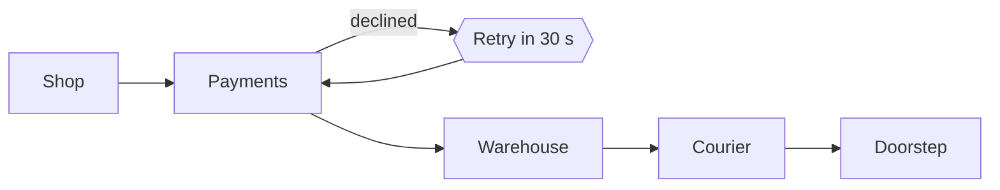

# Appendix: the numbers

Where the time goes, and what each change bought.

Notes: (0.5 min)
Three slides of evidence. Skip them in a short slot; they are here for the questions.

---

## Where an order spends its time

Notes: (1 min)
The only loop in the journey is the payment retry. Everything else moves forward or waits.

---

## Hand-off times, median

| Hand-off | Before | After |
|---|---:|---:|
| Paid to picked | 9 h 40 min | 3 h 05 min |
| Picked to packed | 35 min | 22 min |
| Packed to on a van | 14 h | 13 h 30 min |
| Declined payments recovered | 0% | 61% |

Notes: (1 min)
The big win is paid to picked: the lent picker. Packed to van barely moves because routes leave at fixed times.

---

## Two views of route 7

<!-- layout: two-col -->

<!-- image: ratio=4:3 fit=cover position=left-bottom -->

<!-- column -->

<!-- image: ratio=4:3 fit=cover position=right-bottom -->

Notes: (0.5 min)
Same morning, two ends of the route. On a narrow screen the two pictures stack.
