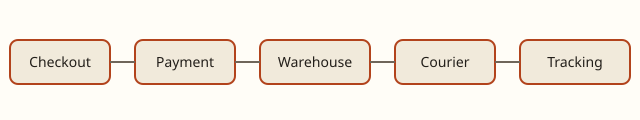

# The order journey

## Five stations

An order passes five stations in a fixed order: ((checkout)), ((payment)),
((warehouse)), ((courier)) and ((tracking)). 
shows them, and  names their owners.

| Station | Owner | Answers within |
|---|---|---|
| Checkout | Web team | 300 ms |
| Payment | Payments team | 15 s (the bank's limit) |
| Warehouse | Operations | the next pick wave |
| Courier | Logistics partner | the route's departure |

Table: Who owns each station

## Hand-offs

A station hands the order on by writing an event; the next station reads it.
No station calls another directly, so a slow station never slows the one
before it. The (((events, hand-off))) events are kept for thirty days.

## What the customer sees

The ((tracking)) page reads the same events. It shows one tile per station and
the promise under them; see .
