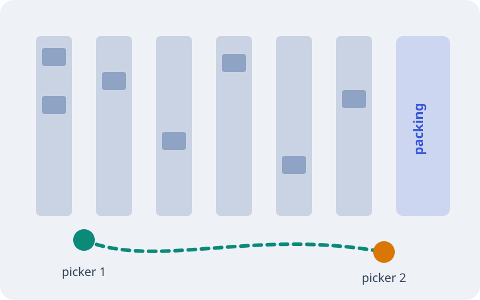

# The Thursday Promise

How one order crosses five teams, fails twice, and still arrives on time.

Notes: (0.5 min)
Welcome. This talk follows a single parcel, order #4711, from the click on "buy" to a doorstep, and the two moments it nearly broke the promise we print at checkout: delivered by Thursday.

---

## One promise, five hand-offs

<!-- steps -->
- The shop promises **Thursday** the moment the customer pays
- Payments, warehouse and courier each own one hand-off
- Every team hits its own target, and still one order in eleven arrives late
- Nobody owns the promise from end to end

Notes: (1 min)
Reveal one line at a time. The point of the last line: each team is green on its own dashboard, and the customer still waits. The promise lives between the teams, so we follow one order across all of them.

---

## The five hand-offs, start to finish

```stage
dir: LR
Order --> Payment --> Warehouse --> Courier --> Delivered
dot Order..Delivered 3s
```

- One order, three teams; the dot is the promise in flight

Notes: (0.5 min)
The same five stations the canvas uses next, drawn flat. The dot is the order moving Thursday-ward across every hand-off.

---

## The journey on one screen

<!-- svg: assets/journey.svg placed -->

- Five stations, one order, three tiles the customer sees on the tracking page

Notes: (1 min)
This canvas stays on screen for the next slides. The stations never move; they light up, fail and recover. The order token at the left is #4711, placed at 21:03 on a Monday. The tiles at the bottom are exactly what the customer sees.

---

## Payment: declined, then paid

<!-- svg: assets/journey.svg +declined -->
<!-- steps: . -declined,retry,paid -->
- 21:04: the card fails a fraud check, the tracking page says so
- 21:05: an automatic retry thirty seconds later goes through

Notes: (1.5 min)
The token reaches payments and turns red: the bank's fraud check declined the card. Step one shows the customer the honest status. Step two is the fix we shipped last quarter: one idempotent retry after thirty seconds. Most declines at night are timeouts, not fraud. Watch the tile change from "payment failed" to "paid".

---

## The warehouse falls behind

<!-- svg: assets/journey.svg +backlog -->
<!-- steps: -backlog,extra packed -->
- Tuesday 06:00: a promotion lands 1,200 orders on one picker, the promise slips to Friday
- 06:20: a second picker joins from returns, the queue drains in 40 minutes
- 07:10: order #4711 is packed, Thursday is back on the tile

Notes: (2 min)
The queue bar under the warehouse fills up and the promised tile turns to "Friday, late". Nobody broke a rule: the promotion simply landed on a shift planned for a normal Tuesday. The fix was a person, not a system: the returns desk lends a picker when the queue passes 500. Then the token moves on to packed.

---

## On the road

<!-- svg: assets/journey.svg +shipped -->
<!-- step: delivered -->

Notes: (1 min)
Route seven, Wednesday morning. Packets flow from the warehouse to the courier, the van appears. Press once more for Thursday 14:32: delivered to Mrs. Okafor's door, the last tile turns green.

---

## What changed after #4711

<!-- layout: two-col -->

### Before

- Each team watched its own queue
- A declined card ended the order
- Promotions were planned by marketing alone

<!-- column -->

### After

- One tracking screen, owned by operations
- One automatic retry, then a message to the customer
- The returns desk lends a picker above 500 waiting orders

Notes: (1.5 min)
Three changes, none of them expensive. Left, what we did before; right, what we do now. The second column is the whole programme.

---

## The retry rule

<!-- layout: split -->

- One retry, thirty seconds later, with the **same** idempotency key
- A second decline is final: the customer gets a message, not silence
- The key makes a double charge impossible

```go
// retry once; the key makes a second charge a no-op
func charge(ctx context.Context, o Order) error {
	key := "order-" + o.ID
	err := payments.Charge(ctx, o.Total, key)
	if errors.Is(err, payments.ErrDeclined) {
		time.Sleep(30 * time.Second)
		err = payments.Charge(ctx, o.Total, key)
	}
	return err
}
```

Notes: (1 min)
The code is short on purpose. The idempotency key is the order id, so the bank treats the retry as the same request: no double charge even if the first call did go through.

---

<!-- layout: big-number -->
<!-- background: linear-gradient(135deg, #1d2b64 0%, #3657d6 55%, #0b8a7a 100%) -->
<!-- transition: zoom -->

**98.7%**

of Thursday promises kept in the first month, up from 91%.

Notes: (0.5 min)
Let the number sit for a moment. From roughly one late order in eleven to about one in eighty.

---

<!-- layout: quote -->

> The customer never saw the declined card or the queue. She saw Thursday.

Route 7 courier log, Thursday 14:32

Notes: (0.5 min)
Read the quote slowly. This is what success looks like from the outside: nothing to notice.

---

## The floor, after the change

<!-- image: width=46% align=right -->


- The second picker starts at the packing end and works backwards
- Pickers meet in the middle aisle, so no order waits for a full walk
- The packing table moved next to the loading door

Notes: (1 min)
The floor plan explains why the second picker drains the queue so fast: two pickers walking towards each other halve the walk for every order. On a phone the plan moves above the text.

---

<!-- layout: image -->

## Wednesday, 05:40


The first vans leave while the city is still asleep.

Notes: (0.5 min)
A breath between the numbers. Route seven leaves at 05:40, so a parcel packed by 07:10 on Tuesday is on Wednesday's first wave.

---

## Every route, every morning

<!-- background: assets/dusk-pan.mp4 poster=assets/dusk.jpg opacity=0.85 overlay=dark -->

- 42 routes leave between 05:30 and 07:00
- Each van carries about 120 parcels
- Thursday promises ride on Wednesday's first wave

Notes: (0.5 min)
The video background loops quietly; with reduced motion turned on the poster frame stays still.

---

<!-- layout: center -->
<!-- transition: slide -->
<!-- class: habits -->
<!-- background: assets/dusk.jpg opacity=0.22 blur=6 -->

## Three habits to keep

1. Follow one order end to end every month
2. Retry once, then tell the customer
3. Lend people before you add systems

The numbers behind each habit are in the [appendix](appendix.md).

Notes: (1 min)
If you remember one slide, remember this one. The appendix carries the numbers for anyone who wants to check them.

---

<!-- include: appendix.md -->

---

# Thank you

Questions about order #4711, the retry rule or the returns desk are welcome.

Notes: (2 min)
Open the floor. Likely questions: why only one retry (fraud teams asked for it), and who pays for the lent picker (operations, from the late-delivery budget it saves).
