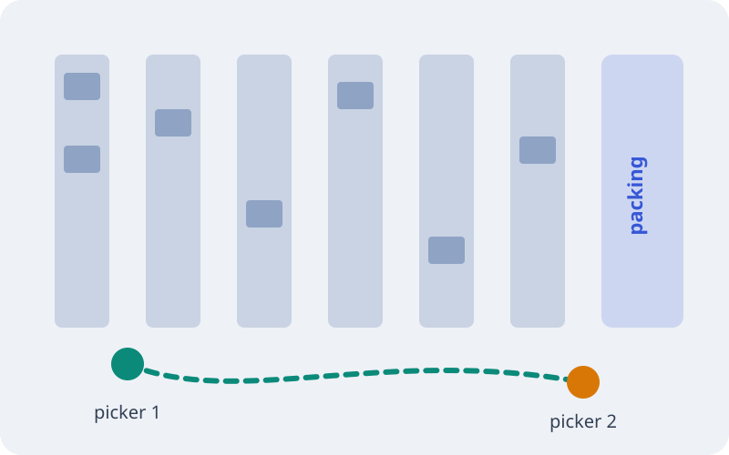

# The Thursday Promise

<!-- footer: off -->

<!-- logo: assets/northwind.svg × Operations · alt=Northwind Logistics -->

<!-- badge: Operations review · Spring 2026 -->

How one order crosses five teams, fails twice, and still arrives on time.

Notes: (0.5 min)
Welcome. This talk follows a single parcel, order #4711, from the click on "buy" to a doorstep, and the two moments it nearly broke the promise we print at checkout: delivered by Thursday.

---

<!-- eyebrow: Order #4711 · the promise -->
## One promise, ==five hand-offs==

<!-- steps -->
- The shop promises **Thursday** the moment the customer pays
- Payments, warehouse and courier each own one hand-off
- Every team hits its own target, and still one order in eleven arrives late
- Nobody owns the promise from end to end

Notes: (1 min)
Look at that last line: each team is green on its own dashboard, and the customer still waits. The promise lives between the teams, so today we follow one order across all of them.

Points: Talking points
- Three teams, three hand-offs, three separate dashboards
- Each hits its own target; one order in eleven is still late
- No single owner for the end-to-end promise

---

## The five hand-offs, start to finish

```stage
dir: LR
Order --> Payment --> Warehouse --> Courier --> Delivered
dot Order..Delivered 3s
```

- One order, three teams; the dot is the promise in flight

Notes: (0.5 min)
The same five stations the canvas uses next, drawn flat. The dot is the order moving Thursday-ward across every hand-off.

---

## The journey on one screen

<!-- svg: assets/journey.svg placed -->

- Five stations, one order, three tiles the customer sees on the tracking page

Notes: (1 min)
Here are the five stations. They never move; they light up, fail and recover. The token on the left is order #4711, placed at 21:03 on a Monday. The tiles at the bottom are exactly what the customer sees.

Points: Canvas
- This picture stays for the next three slides; only its state changes

---

## Payment: declined, then paid

<!-- svg: assets/journey.svg +declined -->
<!-- steps: . -declined,retry,paid -->
- 21:04: the card fails a fraud check, the tracking page says so
- 21:05: an automatic retry thirty seconds later goes through

Notes: (1.5 min)
The token reaches payments and turns red: the bank's fraud check declined the card. First, the customer sees the honest status. Then the fix we shipped last quarter: one idempotent retry after thirty seconds. Most declines at night are timeouts, not fraud. And the tile goes from "payment failed" to "paid".

---

## The warehouse falls behind

<!-- svg: assets/journey.svg +backlog -->
<!-- steps: -backlog,extra packed -->
- Tuesday 06:00: a promotion lands 1,200 orders on one picker, the promise slips to Friday
- 06:20: a second picker joins from returns, the queue drains in 40 minutes
- 07:10: order #4711 is packed, Thursday is back on the tile

Notes: (2 min)
The queue bar under the warehouse fills up and the promised tile turns to "Friday, late". Nobody broke a rule: the promotion simply landed on a shift planned for a normal Tuesday. The fix was a person, not a system: the returns desk lends a picker when the queue passes 500. Then the token moves on to packed.

---

## On the road

<!-- svg: assets/journey.svg +shipped -->
<!-- step: delivered -->

Notes: (1 min)
Route seven, Wednesday morning. Packets flow from the warehouse to the courier, and the van sets off. Thursday, 14:32: delivered to Mrs. Okafor's door, and the last tile turns green.

Points: Delivery
- One more step reveals the delivery; let the green tile land

---

## What changed after #4711

<!-- layout: two-col -->

### Before

- Each team watched its own queue
- A declined card ended the order
- Promotions were planned by marketing alone

<!-- column -->

### After

- One tracking screen, owned by operations
- One automatic retry, then a message to the customer
- The returns desk lends a picker above 500 waiting orders

Notes: (1.5 min)
Three changes, none of them expensive. Left, what we did before; right, what we do now. The second column is the whole programme.

---

## The retry rule

<!-- layout: split -->

- One retry, thirty seconds later, with the **same** idempotency key
- A second decline is final: the customer gets a message, not silence
- The key makes a double charge impossible

```go id=charge window=mac title="charge.go" step="Before #4711"
// one try: a timeout became a "payment failed" email
func charge(ctx context.Context, o Order) error {
	return payments.Charge(ctx, o.Total, "order-"+o.ID)
}
```

```go id=charge window=mac title="charge.go" step="After #4711" hl=3-8
// retry once; the key makes a second charge a no-op
func charge(ctx context.Context, o Order) error {
	key := "order-" + o.ID
	err := payments.Charge(ctx, o.Total, key)
	if errors.Is(err, payments.ErrDeclined) {
		time.Sleep(30 * time.Second)
		err = payments.Charge(ctx, o.Total, key)
	}
	return err
}
```
<!-- callout: 3 The order id is the idempotency key -->
<!-- callout: 6 Thirty seconds: the bank's batch is done by then -->

Notes: (1 min)
Before the change, checkout called the bank once, and a timeout became a failed-payment email. [CLICK] After order 4711 it waits thirty seconds and tries again with the same key. The idempotency key is the order id, so the bank treats the retry as the same request: no double charge even if the first call did go through.

---

<!-- layout: big-number -->
<!-- background: linear-gradient(135deg, #1d2b64 0%, #3657d6 55%, #0b8a7a 100%) -->
<!-- transition: zoom -->

**98.7%**

of Thursday promises kept in the first month, up from 91%.

Notes: (0.5 min)
Ninety-eight point seven percent. We went from roughly one late order in eleven to about one in eighty.

Points: The number
- Say the number, then pause before the comparison

---

<!-- layout: quote -->

> The customer never saw the declined card or the queue. She saw Thursday.

Route 7 courier log, Thursday 14:32

Notes: (0.5 min)
The customer never saw the declined card or the queue. She saw Thursday. This is what success looks like from the outside: nothing to notice.

Points: Quote
- Read it slowly; it is the emotional end of the story

---

## The floor, after the change

<!-- image: width=46% align=right -->


- The second picker starts at the packing end and works backwards
- Pickers meet in the middle aisle, so no order waits for a full walk
- The packing table moved next to the loading door

Notes: (1 min)
The floor plan explains why the second picker drains the queue so fast: two pickers walking towards each other halve the walk for every order.

---

<!-- layout: image -->

## Wednesday, 05:40


The first vans leave while the city is still asleep.

Notes: (0.5 min)
Route seven leaves at 05:40, while the city is still asleep. A parcel packed by 07:10 on Tuesday rides Wednesday's first wave.

Points: Breather
- A quiet slide between the numbers; keep it short

---

## Every route, every morning

<!-- background: assets/dusk-pan.mp4 poster=assets/dusk.jpg opacity=0.85 overlay=dark -->

- 42 routes leave between 05:30 and 07:00
- Each van carries about 120 parcels
- Thursday promises ride on Wednesday's first wave

Notes: (0.5 min)
Forty-two routes leave between half past five and seven, each van with about a hundred and twenty parcels. Every Thursday promise rides on Wednesday's first wave.

---

<!-- layout: center -->
## Where a promise breaks

```mindmap steps flow=on layout=right
# A late parcel
- Payment
  - Bank timeout
  - Fraud review
- Warehouse
  - One short-staffed shift
- Road
  - A cut-off that leaves too early
```

Notes: (1 min)
A late parcel almost always has one of three causes. [CLICK] Payment: a bank timeout, or a fraud review that holds the order overnight. [CLICK] The warehouse: one short-staffed shift is enough. [CLICK] And the road: a cut-off that leaves before the last parcels are packed.

Points: Three causes, one per click
- Payment and warehouse are the two we fixed
- The road cut-off is still open: ask ops

---

<!-- transition: slide -->
<!-- class: habits -->
<!-- background: assets/dusk.jpg opacity=0.22 blur=6 -->

## Three habits to keep

1. Follow one order end to end every month
2. Retry once, then tell the customer
3. Lend people before you add systems

The numbers behind each habit are in the [appendix](appendix.md).

Notes: (1 min)
If you remember one slide, remember this one. The appendix carries the numbers for anyone who wants to check them.

---

<!-- include: appendix.md -->

---

<!-- labs: [Open the demo workspace](https://example.com/demo) -->

Notes: (1 min) Hands-on: open the sample workspace and send order #4711 through the two failure points yourself.

---

# Thank you

Questions about order #4711, the retry rule or the returns desk are welcome.

Notes: (2 min)
Thank you. I am happy to take questions: about order #4711, the retry rule or the returns desk.

Points: Likely questions
- Why only one retry: the fraud team asked for it
- Who pays for the lent picker: operations, from the late-delivery budget it saves
