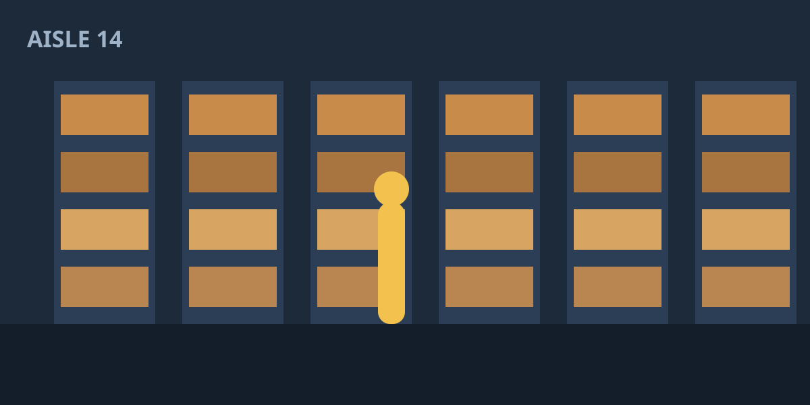
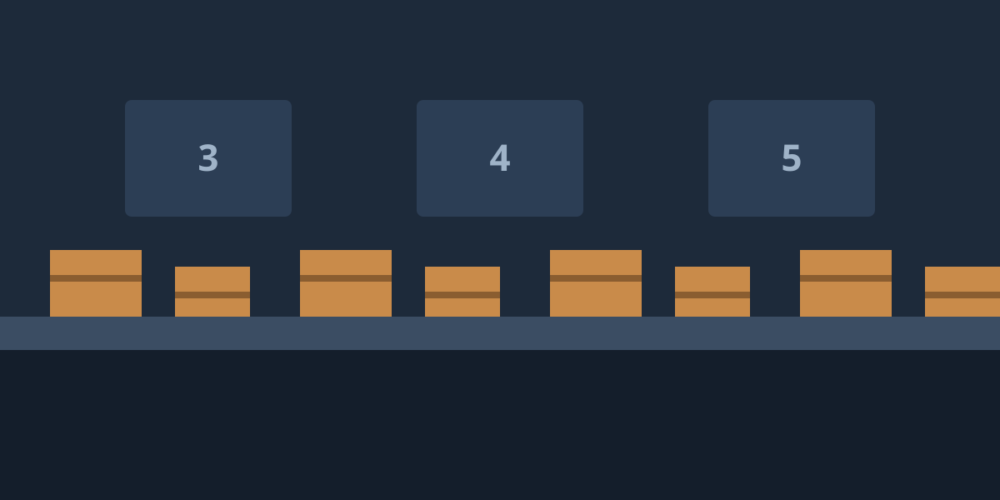
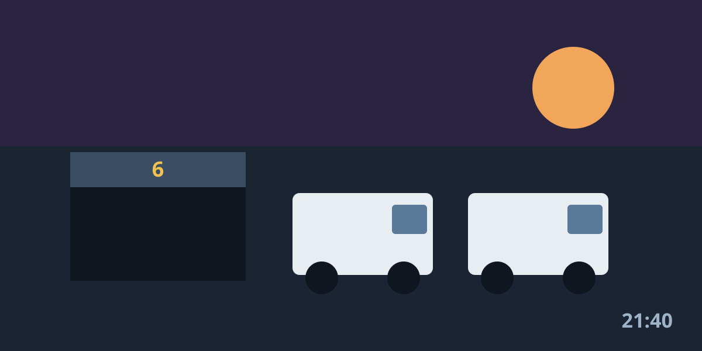

<!-- alert: The order lab moves to the new cluster on 24 November; the old endpoints stop answering that morning. · until=2026-11-25 · warn -->

<!-- badge: Pipeline healthy, p95 checkout 410 ms · ok -->

<!-- event: 2026-11-20T17:00 Live: replaying Black Friday 2025 · Save a seat → #seat -->

Every order that leaves a Northwind warehouse passes through the same five
services: checkout, payment, stock, picking and the courier hand-off. This
site is where we write down how they behave, how they fail, and what we
changed after each incident.

## From the floor

<!-- carousel: auto=7s -->

## Read, watch, run

<!-- embed: blog/retries.md -->

<!-- embed: talks/journey.md 1-3 -->

<!-- embed: docs/ -->

## Questions we get

<!-- accordion -->

### Can I run the lab on a laptop?

Yes. It needs Docker and about 4 GB of memory. The whole pipeline starts
with one command and fits on an 8 GB machine with a browser open.

### Is the lab the real code?

It is a trimmed copy: the same services and queues, with the courier and
payment providers replaced by stubs that answer in a few milliseconds.

### How often do you publish?

Roughly once a month, and always after an incident review that taught us
something we did not know.

<!-- modal: seat -->

### Save a seat

The replay starts at 17:00 CET on 20 November and runs for 45 minutes. We
walk through the night's queue depths minute by minute and answer questions
at the end.

Write to **events@northwind.example** with the subject *Replay* and we send
the link the day before.

<!-- end -->
