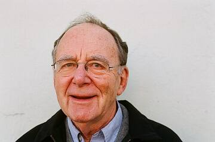
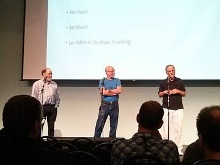
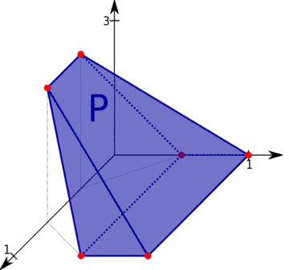
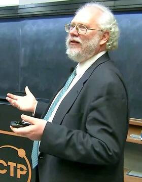
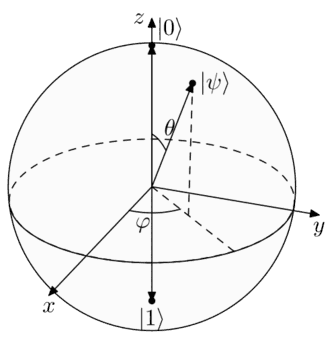
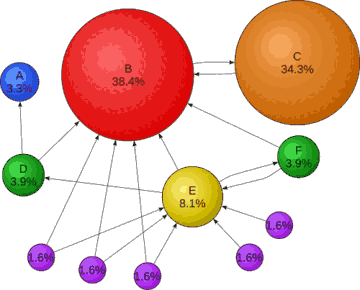
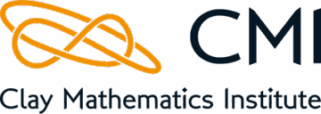

## Teoría de la complejidad

### 1965 · Nace la teoría de la complejidad
Hartmanis y Stearns publican "On the computational complexity of algorithms"; ese mismo año Edmonds y Cobham proponen el tiempo polinomial como sinónimo de "eficiente".

### 1968 · "The Art of Computer Programming"
Donald Knuth publica el primer volumen y populariza el análisis de algoritmos y la notación O grande.

### 1971 · Teorema de Cook
Stephen Cook demuestra que el problema SAT es NP-completo y plantea la pregunta P vs NP (Leonid Levin llega al mismo resultado en 1973).

### 1972 · Los 21 problemas de Karp
Richard Karp demuestra que 21 problemas clásicos son NP-completos.

### 1977 · Algoritmo RSA
Rivest, Shamir y Adleman crean la criptografía de clave pública basada en la dificultad de factorizar números grandes.

### 1984 · Algoritmo de Karmarkar
Narendra Karmarkar presenta un método de punto interior que resuelve la programación lineal en tiempo polinomial y es eficiente en la práctica.

## Internet y computación cuántica

### 1994 · Algoritmo de Shor
Peter Shor demuestra que una computadora cuántica podría factorizar números en tiempo polinomial, lo que pondría en riesgo a RSA.

### 1996 · Algoritmo de Grover
Lov Grover propone una búsqueda cuántica en una lista no ordenada en tiempo proporcional a la raíz cuadrada de n.

### 1998 · PageRank
Larry Page y Sergey Brin publican el algoritmo que ordena páginas web por relevancia y da origen a Google.

### 2000 · P vs NP, Problema del Milenio
El Instituto Clay ofrece un millón de dólares a quien resuelva la pregunta P vs NP.

### 2002 · Algoritmo AKS
Agrawal, Kayal y Saxena (India) demuestran que saber si un número es primo se puede decidir en tiempo polinomial.

