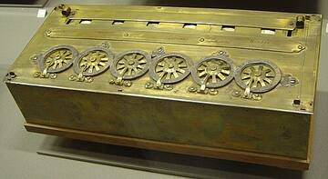
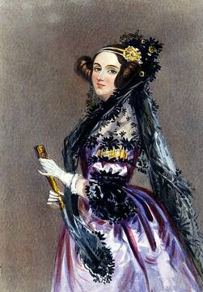
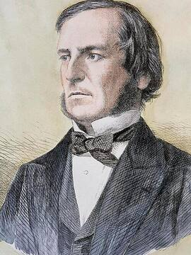
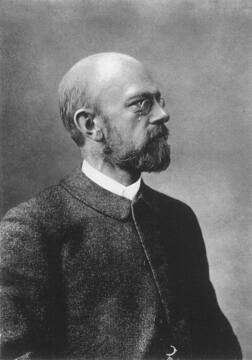
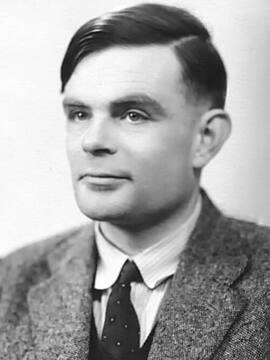
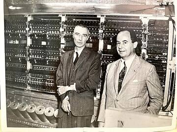
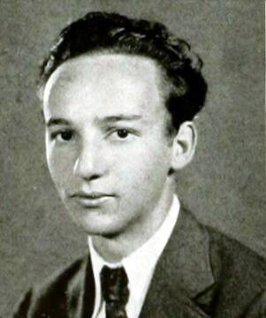
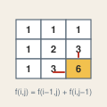
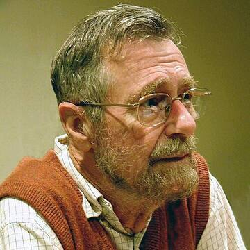
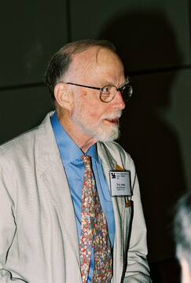

## Máquinas y lógica

### 1642 · La Pascalina
Blaise Pascal construye una calculadora mecánica que suma y resta.

### 1843 · Ada Lovelace, primer programa
En sus notas sobre la Máquina Analítica de Babbage publica un algoritmo para calcular números de Bernoulli.

### 1854 · Álgebra de Boole
George Boole publica "Las leyes del pensamiento", base lógica de los circuitos digitales.

### 1928 · El problema de la decisión
Hilbert y Ackermann preguntan si existe un procedimiento mecánico para decidir cualquier enunciado matemático.

## Fundamentos de la computación

### 1936 · Máquina de Turing
Alan Turing y Alonzo Church definen formalmente qué es computable y demuestran que hay problemas sin solución algorítmica.

### 1945 · Arquitectura de von Neumann y Mergesort
John von Neumann describe la computadora de programa almacenado y propone el ordenamiento por mezcla.

### 1947 · Método símplex
George Dantzig crea el algoritmo para resolver problemas de programación lineal.

### 1957 · Programación dinámica
Richard Bellman publica "Dynamic Programming", técnica para resolver problemas dividiéndolos en subproblemas que se reutilizan.

### 1959 · Algoritmo de Dijkstra
Edsger Dijkstra publica su algoritmo para encontrar el camino más corto en un grafo.

### 1961 · Quicksort
Tony Hoare publica Quicksort, uno de los algoritmos de ordenamiento más rápidos en la práctica.

