## Antigüedad

### c. 300 a.C. · Algoritmo de Euclides
En "Los Elementos" (libro VII) Euclides describe el método para calcular el máximo común divisor; es el algoritmo no trivial más antiguo que se sigue usando.
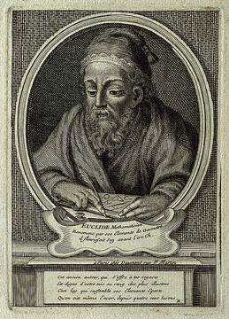

### c. 240 a.C. · Criba de Eratóstenes
Método sistemático para encontrar todos los números primos hasta un límite dado.
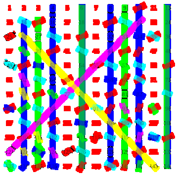

## Edad Media

### c. 825 · Al-Juarismi
Escribe su tratado sobre el cálculo con numerales indios; la traducción latina de su nombre ("Algoritmi") da origen a la palabra "algoritmo".
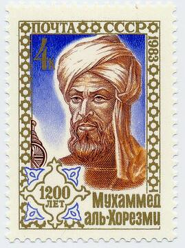

### 1202 · Fibonacci publica "Liber Abaci"
Difunde en Europa los numerales indoarábigos y los procedimientos de cálculo; incluye la famosa sucesión.
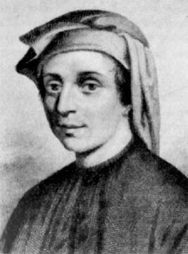

## Máquinas y lógica

### 1642 · La Pascalina
Blaise Pascal construye una calculadora mecánica que suma y resta.
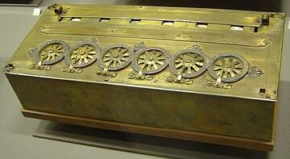

### 1843 · Ada Lovelace, primer programa
En sus notas sobre la Máquina Analítica de Babbage publica un algoritmo para calcular números de Bernoulli.
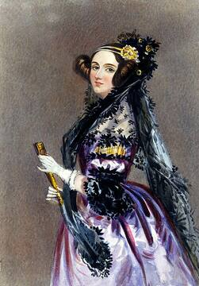

### 1854 · Álgebra de Boole
George Boole publica "Las leyes del pensamiento", base lógica de los circuitos digitales.
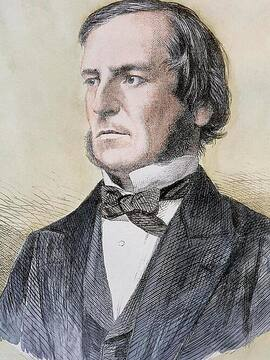

### 1928 · El problema de la decisión
Hilbert y Ackermann preguntan si existe un procedimiento mecánico para decidir cualquier enunciado matemático.
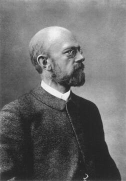

## Fundamentos de la computación

### 1936 · Máquina de Turing
Alan Turing y Alonzo Church definen formalmente qué es computable y demuestran que hay problemas sin solución algorítmica.
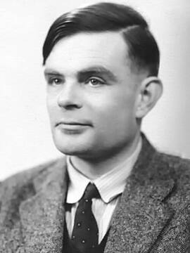

### 1945 · Arquitectura de von Neumann y Mergesort
John von Neumann describe la computadora de programa almacenado y propone el ordenamiento por mezcla.
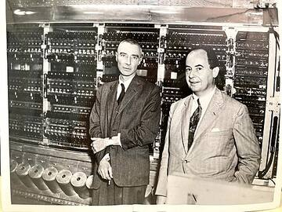

### 1947 · Método símplex
George Dantzig crea el algoritmo para resolver problemas de programación lineal.
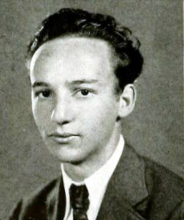

### 1957 · Programación dinámica
Richard Bellman publica "Dynamic Programming", técnica para resolver problemas dividiéndolos en subproblemas que se reutilizan.
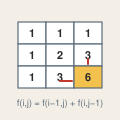

### 1959 · Algoritmo de Dijkstra
Edsger Dijkstra publica su algoritmo para encontrar el camino más corto en un grafo.
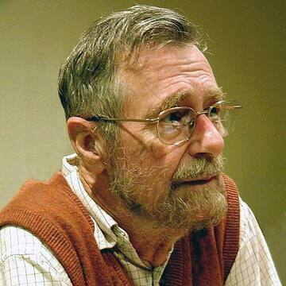

### 1961 · Quicksort
Tony Hoare publica Quicksort, uno de los algoritmos de ordenamiento más rápidos en la práctica.
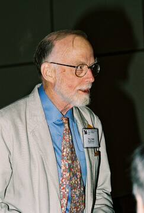

## Teoría de la complejidad

### 1965 · Nace la teoría de la complejidad
Hartmanis y Stearns publican "On the computational complexity of algorithms"; ese mismo año Edmonds y Cobham proponen el tiempo polinomial como sinónimo de "eficiente".
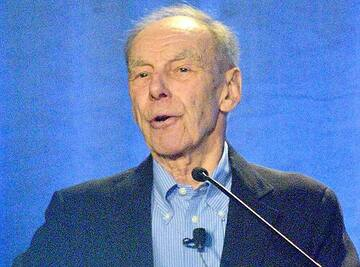

### 1968 · "The Art of Computer Programming"
Donald Knuth publica el primer volumen y populariza el análisis de algoritmos y la notación O grande.
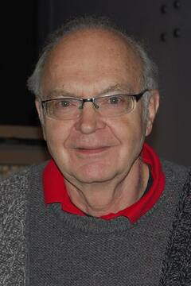

### 1971 · Teorema de Cook
Stephen Cook demuestra que el problema SAT es NP-completo y plantea la pregunta P vs NP (Leonid Levin llega al mismo resultado en 1973).
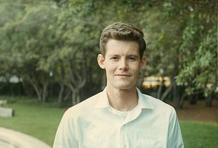

### 1972 · Los 21 problemas de Karp
Richard Karp demuestra que 21 problemas clásicos son NP-completos.
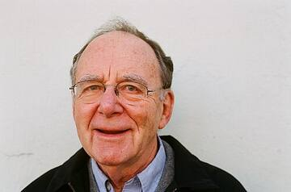

### 1977 · Algoritmo RSA
Rivest, Shamir y Adleman crean la criptografía de clave pública basada en la dificultad de factorizar números grandes.
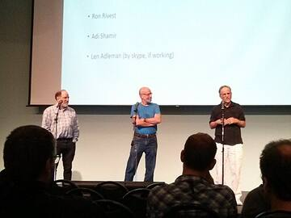

### 1984 · Algoritmo de Karmarkar
Narendra Karmarkar presenta un método de punto interior que resuelve la programación lineal en tiempo polinomial y es eficiente en la práctica.
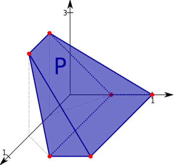

## Internet y computación cuántica

### 1994 · Algoritmo de Shor
Peter Shor demuestra que una computadora cuántica podría factorizar números en tiempo polinomial, lo que pondría en riesgo a RSA.
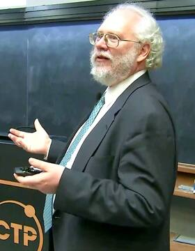

### 1996 · Algoritmo de Grover
Lov Grover propone una búsqueda cuántica en una lista no ordenada en tiempo proporcional a la raíz cuadrada de n.
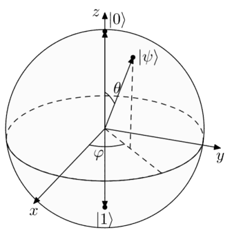

### 1998 · PageRank
Larry Page y Sergey Brin publican el algoritmo que ordena páginas web por relevancia y da origen a Google.
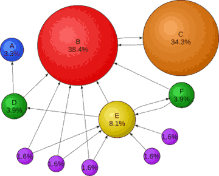

### 2000 · P vs NP, Problema del Milenio
El Instituto Clay ofrece un millón de dólares a quien resuelva la pregunta P vs NP.
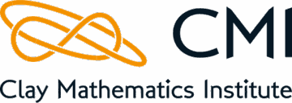

### 2002 · Algoritmo AKS
Agrawal, Kayal y Saxena (India) demuestran que saber si un número es primo se puede decidir en tiempo polinomial.
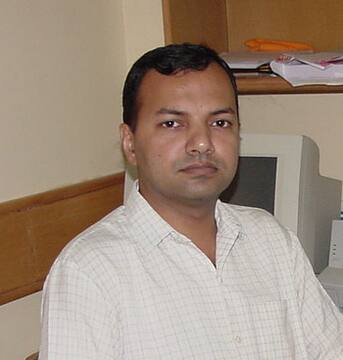

## Era de la inteligencia artificial

### 2015 · Isomorfismo de grafos
László Babai anuncia un algoritmo cuasipolinomial para el isomorfismo de grafos.
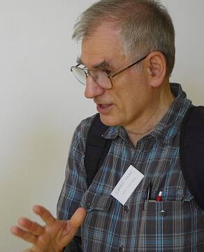

### 2016 · AlphaGo vence a Lee Sedol
DeepMind combina búsqueda en árbol Monte Carlo con redes neuronales para vencer al campeón mundial de Go.
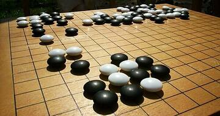

### 2017 · Arquitectura Transformer
El artículo "Attention is all you need" (Google) introduce la base de los modelos de lenguaje modernos como ChatGPT y Claude.
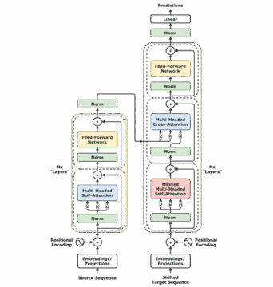

### 2019 · Ventaja cuántica con Sycamore
Google reporta que su procesador cuántico Sycamore resolvió en minutos un cálculo que una supercomputadora clásica tardaría mucho más.
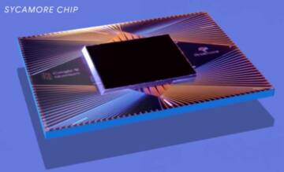

### 2022–2024 · La IA descubre algoritmos y el NIST publica criptografía poscuántica
AlphaTensor (2022) encuentra formas más rápidas de multiplicar matrices; en 2024 el NIST publica los primeros estándares criptográficos resistentes a computadoras cuánticas.
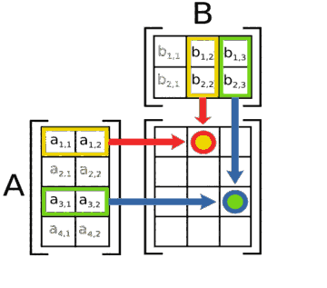

## Fuentes · sources

- Cormen, T. H., Leiserson, C. E., Rivest, R. L., y Stein, C. (2022). Introduction to algorithms (4.ª ed.). MIT Press.
- Gómez Fuentes, M. C., y Cervantes Ojeda, J. (s.f.). Introducción al análisis y al diseño de algoritmos. UAM.
- Fortnow, L. (2013). The golden ticket: P, NP, and the search for the impossible. Princeton University Press.
- Clay Mathematics Institute. (2000). P vs NP problem. https://www.claymath.org/millennium/p-vs-np/
- Imágenes: Wikimedia Commons (autor y licencia al pie de cada una).

Notes: (5 min) Esta línea recorre más de dos mil años de algoritmos. Empieza en la Antigüedad, con Euclides y Eratóstenes, que ya seguían pasos precisos para resolver problemas de números. [CLICK] En la Edad Media, Al-Juarismi le da nombre a la palabra algoritmo, y Fibonacci lleva esos métodos a Europa. [CLICK] Luego llegan las máquinas y la lógica: la Pascalina, el primer programa de Ada Lovelace, el álgebra de Boole y la pregunta de Hilbert. [CLICK] En el siglo veinte, Turing define qué es computable, y nacen los algoritmos que usamos a diario, de Dijkstra a Quicksort. [CLICK] Después aprendemos a medir cuánto cuesta resolver un problema, y aparece la pregunta P contra NP. [CLICK] Internet y la computación cuántica cambian las reglas: Shor, Grover y PageRank. [CLICK] Y hoy la inteligencia artificial descubre algoritmos nuevos. Aun así, la pregunta de 1971 sigue sin respuesta.

Points:
- Siete épocas, treinta hitos: una por clic
- El hilo conductor: de los pasos a mano a la pregunta P vs NP
- Si preguntan por Bellman: no hay retrato libre; la tabla ilustra su idea
