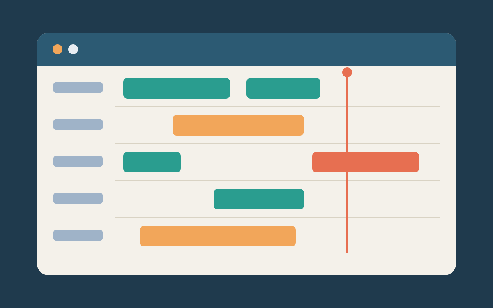
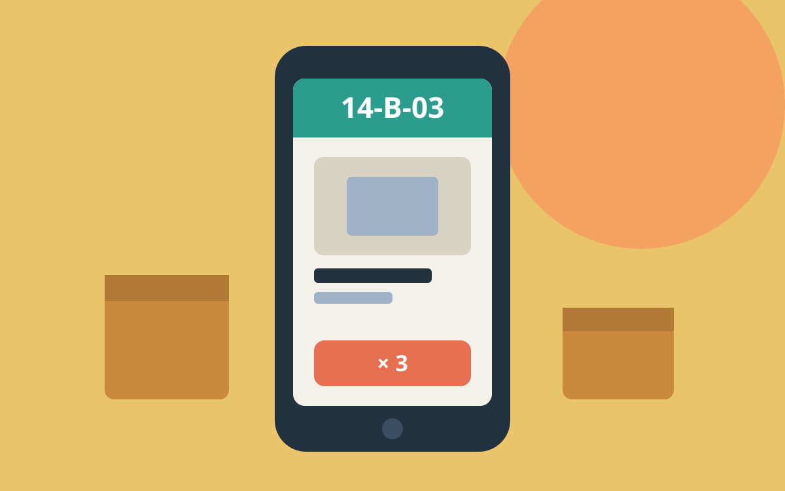
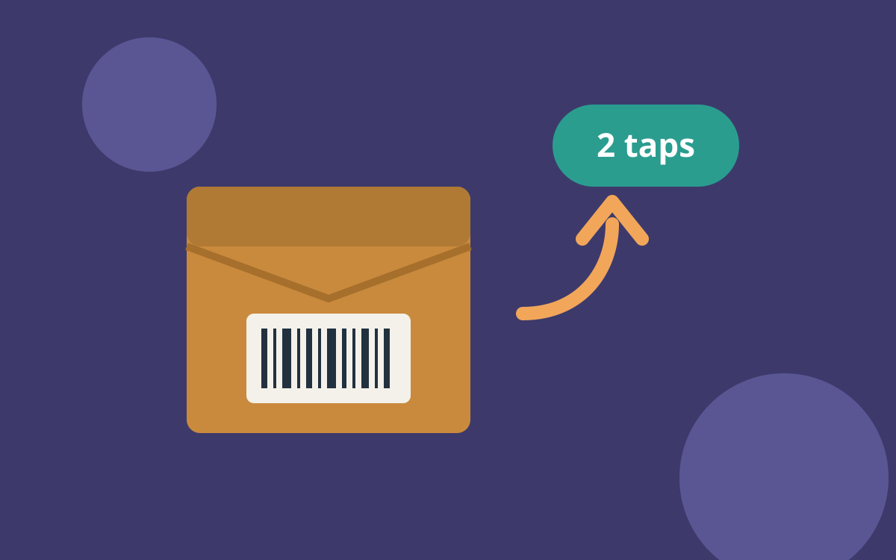

<!-- badge: Booking projects from February · ok -->

## Selected work

<!-- cards: 3 -->

### [The dock board](work/dock-board.md) · Northwind Logistics · teal

One screen for twelve dock doors. **Late departures down by a third.**

### [A handheld for pickers](work/picker.md) · Northwind Logistics · orange

Big type, one task per screen. **Picking errors halved in a month.**

### [Returns in two taps](work/returns.md) · Borås Home · hi

No printer, no form. **Support calls about returns down 60%.**

## How I work

I start on the floor, not in the file. Every project begins with two days
beside the people who will use the screen, and ends when they stop asking me
how it works.
