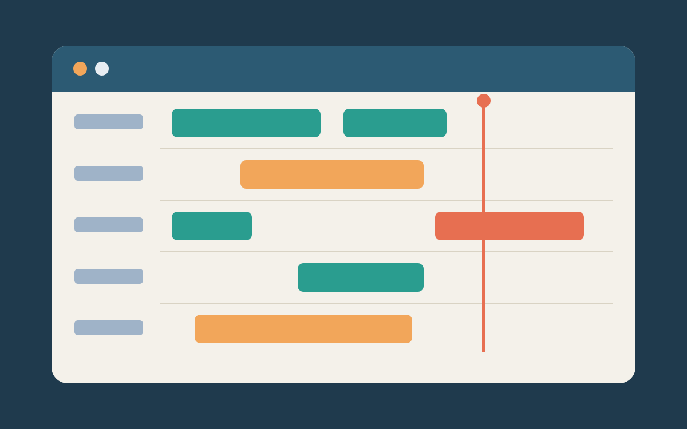

## The problem

At the Borås warehouse the evening departures were planned on a whiteboard
and three spreadsheets. When a van ran late, the planner found out from the
driver, and every door after it slipped.

## What we made

A board with one row per door and one bar per booking. A bar turns orange
when its van is ten minutes late and red when it blocks the next one. The
planner drags a bar to another door; the drivers' phones update at once.

- Readable from eight metres: the door number is the biggest thing on screen.
- Three colours only, each with a word beside it for colour-blind readers.
- Works on the wall screen and on the planner's tablet, the same layout.

## What changed

Late departures fell by a third in the first peak season, and the
whiteboard came down in week two. The planners asked for one more thing: a
line that shows the time now. It is the red line in the picture.
