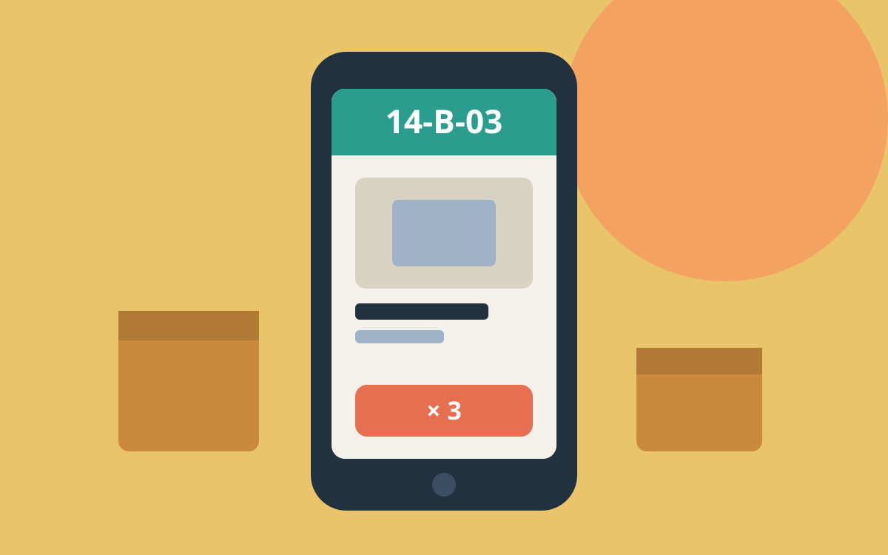

## The problem

Pickers at aisle 14 used an app made for office screens: small type, six
fields per screen, and a confirm button the size of a fingernail. Wrong
picks cost Northwind a re-delivery each.

## What we made

One task per screen: where to go, what to take, how many. The shelf code
fills the top third; the quantity sits on the only button. A wrong scan
buzzes twice and shows the right shelf, never an error code.

## What changed

Picking errors halved within a month, and new pickers were up to speed in
one shift instead of three. The app now runs in all four Northwind
warehouses.
