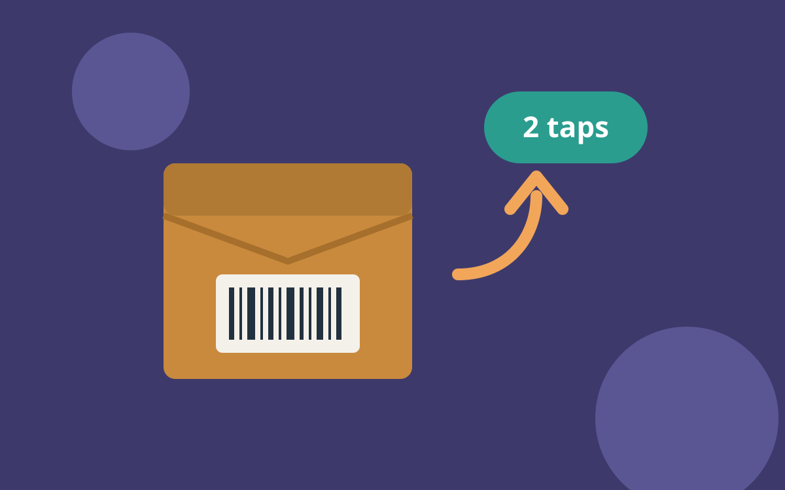

## The problem

Borås Home asked customers to print a form, fill in an order number and
call to book a pickup. Most of them called first to ask how.

## What we made

Two taps in the order e-mail: *Send it back*, then a pickup day. The
customer gets a code on their phone; the courier scans it at the door and
brings the label. No printer, no form, no call.

## What changed

Support calls about returns fell by 60% in three months, and returned
parcels reached the warehouse two days sooner on average.
